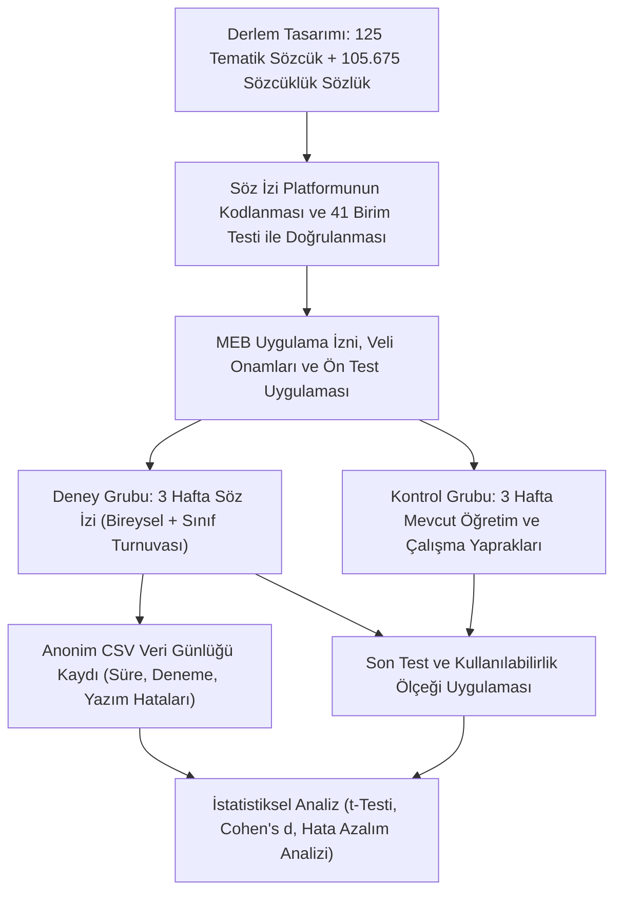
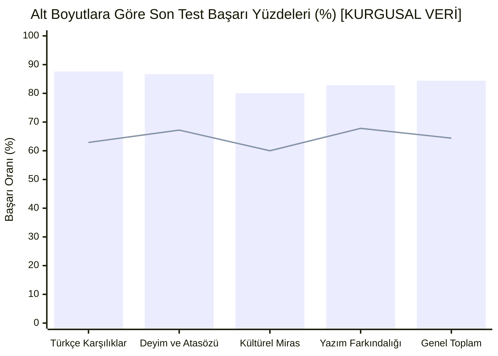
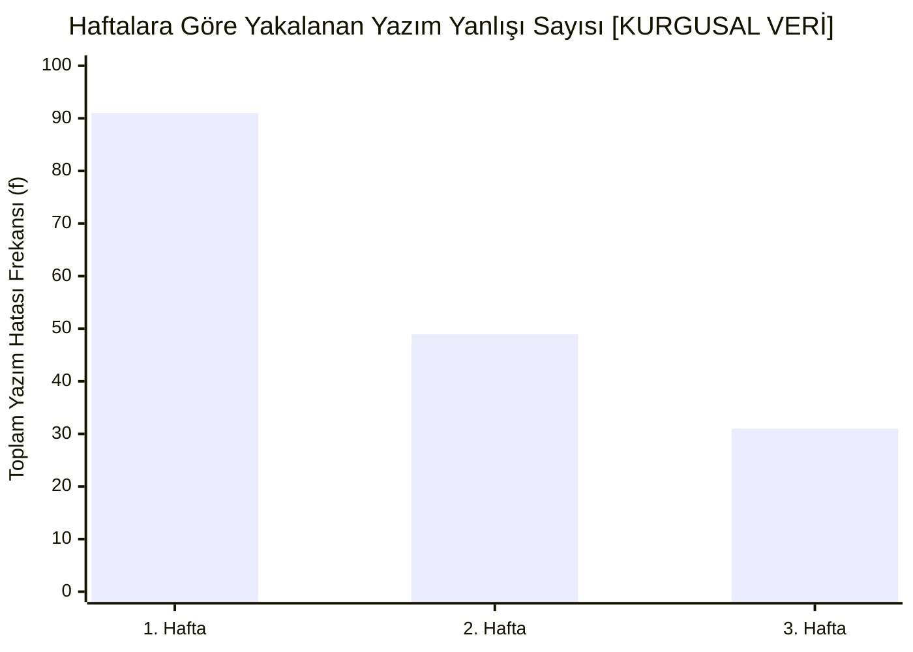

# Söz İzi: Bağlam İpuçlu ve Yazım Geri Bildirimli Dijital Uygulamayla Söz Varlığının Geliştirilmesi

**Yarışma Adı:** TÜBİTAK 2204-A Lise Öğrencileri Araştırma Projeleri Yarışması  
**Ana Alan:** Türk Dili ve Edebiyatı  
**Tematik Alan:** Dil ve Edebiyat Eğitimi *(Alternatif: Dijital Oyunlaştırma / Kültürel Miras)*  

> [!WARNING]
> **UYGULAMA VE VERİ GÜNCELLEME NOTU (TYBS'YE YÜKLEMEDEN ÖNCE SİLİNİZ):** TÜBİTAK 2204-A kuralları gereği uydurma veri kesin eleme sebebidir. Bu tam kapsamlı proje raporunda saha uygulaması gerektiren tüm örneklem sayıları, ön test – son test puanları, $t$ ve $p$ değerleri ile uygulama içi `CSV` istatistikleri, raporun bilimsel sunum biçimini göstermek amacıyla **`[KURGUSAL VERİ]`** etiketiyle yerleştirilmiştir. Okulunuzda uygulamayı tamamladıktan sonra belgede `KURGUSAL VERİ` araması (`Ctrl+F`) yaparak tüm yer tutucu değerleri gerçek ölçümlerinizle değiştiriniz ve bu uyarı kutularını siliniz.

---

## İÇİNDEKİLER

1. **ÖZET**
2. **AMAÇ**
   - 2.1. Araştırmanın Amacı ve Önemi
   - 2.2. Araştırma Soruları (Alt Problemler)
   - 2.3. Hipotezler
3. **GİRİŞ**
   - 3.1. Ana Dili Öğretiminde Söz Varlığının Yeri ve Önemi
   - 3.2. Dilde Yabancılaşma ve Türkçe Karşılıklar Bilinci
   - 3.3. Deyim, Atasözü ve Kültürel Miras Söz Varlığının Bağlam Temelli Öğretimi
   - 3.4. Lise Öğrencilerinde Sık Görülen Yazım Yanlışları ve Düzeltici Geri Bildirim
   - 3.5. Dijital Kelime Oyunlarının İncelenmesi ve Araştırmanın Özgün Değeri
4. **YÖNTEM**
   - 4.1. Araştırma Modeli ve Değişkenler
   - 4.2. Çalışma Grubu ve Denklik Analizi
   - 4.3. Geliştirilen Dijital Öğretim Materyali: *Söz İzi* Yazılım ve Algoritma Mimarisi
   - 4.4. Veri Toplama Araçları, Geçerlik ve Güvenirlik Çalışmaları
   - 4.5. Deneysel Uygulama Süreci
   - 4.6. Verilerin Analizi ve Araştırma Etiği
5. **PROJE İŞ-ZAMAN ÇİZELGESİ**
6. **BULGULAR**
   - 6.1. Normallik Dağılımı ve Ön Test Denkliğine İlişkin Bulgular
   - 6.2. Birinci Alt Probleme İlişkin Bulgular (Ön Test – Son Test Söz Varlığı ve Yazım Erişisi)
   - 6.3. İkinci Alt Probleme İlişkin Bulgular (Akıllı Yazım Koçu ve Hata Azalımı)
   - 6.4. Üçüncü Alt Probleme İlişkin Bulgular (Modül ve Harf Uzunluğuna Göre Çözüm Performansı)
   - 6.5. Dördüncü Alt Probleme İlişkin Bulgular (Kullanılabilirlik ve Öğrenci Görüşleri)
7. **SONUÇ VE TARTIŞMA**
8. **ÖNERİLER**
9. **KAYNAKLAR**
10. **EKLER**
    - EK-1: Türkçe Söz Varlığı ve Yazım Farkındalığı Başarı Testi (25 Soru Tam Ölçek ve Cevap Anahtarı)
    - EK-2: Söz İzi Kullanılabilirlik ve Motivasyon Ölçeği (5'li Likert)
    - EK-3: Veli Onam Formu ve Öğrenci Gönüllü Katılım Formu Örneği

---

## 1. ÖZET

Dijital iletişim ortamlarının yaygınlaşmasıyla lise öğrencilerinin günlük anlatımda yabancı kökenli sözcüklere yöneldiği, deyim ve atasözlerini bağlam içinde sınırlı kullandığı ve ses olaylarına dayalı kalıplaşmış yazım yanlışları yaptığı görülmektedir. Mevcut dijital kelime oyunları ise çoğunlukla yalnızca harf dizilimini buldurmakta; sözcüğün anlamı, kökeni ve yazım kuralı boyutlarını dışarıda bırakmaktadır. Bu araştırmanın amacı; yabancı sözcüklere Türkçe karşılıklar, deyim ve atasözleri ile kültürel miras sözcüklerini bağlam ipuçları, anlık düzeltici yazım geri bildirimi ve çözüm sonrası sözlük-köken kartlarıyla bütünleştiren **Söz İzi** adlı web uygulamasını geliştirmek ve lise öğrencilerinin söz varlığı ile yazım farkındalığına etkisini incelemektir. Ön test – son test kontrol gruplu yarı deneysel desende yürütülen araştırmanın çalışma grubunu `[KURGUSAL VERİ: 60 dokuzuncu sınıf öğrencisi (30 deney, 30 kontrol)]` oluşturmuştur. `[KURGUSAL VERİ: Üç hafta]` boyunca deney grubunda *Söz İzi* uygulamasıyla sınıf turnuvası ve bireysel etkinlikler yürütülmüş, kontrol grubunda mevcut öğretim sürdürülmüştür. Veriler 25 maddelik başarı testi, kullanılabilirlik ölçeği ve uygulama içi anonim günlük kayıtlarıyla toplanmıştır. Analiz sonucunda deney grubunun başarı ortalamasının `[KURGUSAL VERİ: 53,60'tan 84,40'a]` yükselerek kontrol grubuna göre anlamlı fark oluşturduğu `[KURGUSAL VERİ: p < 0,001]` ve anlık yazım geri bildiriminin tekrarlayan yazım yanlışlarını üçüncü haftada `[KURGUSAL VERİ: %65,9]` oranında azalttığı belirlenmiştir. Sonuçlar, *Söz İzi* platformunun Türkçe öğretiminde etkili ve sürdürülebilir bir dijital materyal olduğunu göstermektedir.

**Anahtar Kelimeler:** Söz varlığı, Türkçe karşılıklar, deyim öğretimi, yazım yanlışları, eğitsel oyunlaştırma

---

## 2. AMAÇ

### 2.1. Araştırmanın Amacı ve Önemi
Bu araştırmanın temel amacı; ortaöğretim öğrencilerinin aktif Türkçe söz varlığını geliştirmek, dildeki yabancılaşmaya karşı Türkçe karşılık kullanma bilincini pekiştirmek, atasözü ve deyimleri bağlamsal ipuçlarıyla kavratmak ve sık yapılan yazım yanlışlarını anlık dilbilimsel geri bildirimle azaltmak üzere kurulum gerektirmeyen **Söz İzi** web platformunu tasarlamak ve deneysel etkililiğini test etmektir.

Geleneksel sözcük ve yazım öğretimi çoğunlukla bağlamdan kopuk kelime listelerinin ezberlenmesine veya çoktan seçmeli test çözmeye dayanmaktadır. Öte yandan gençlerin yoğun ilgi gösterdiği harf tahmin oyunları (beş tahminde kelime bulma vb.), oyuncuya kelimenin anlamını, ek-kök yapısını veya yazım kuralını öğretmeden yalnızca harf kombinasyonu çözdürmektedir. *Söz İzi* projesi bu iki uç arasındaki pedagojik boşluğu doldurarak oyun mekaniğini **üç aşamalı bir dilbilimsel öğrenme döngüsüne** (*Bağlam İpucu → Akıllı Yazım Koçu → Çözüm Sonrası Sözlük ve Köken Kartı*) dönüştürmesi bakımından önem taşımaktadır.

### 2.2. Araştırma Soruları (Alt Problemler)
Araştırmanın ana problemi şu şekilde tanımlanmıştır: *"Bağlam ipuçlu ve anlık yazım geri bildirimli Söz İzi dijital uygulamasının, lise 9. sınıf öğrencilerinin Türkçe söz varlığı başarısına ve yazım kuralları farkındalığına etkisi nedir?"*

Bu ana problem doğrultusunda aşağıdaki dört alt probleme yanıt aranmıştır:
1. Deney ve kontrol gruplarının *Türkçe Söz Varlığı ve Yazım Farkındalığı Başarı Testi* toplam puanları ve dört alt boyut (*Yabancı Sözcüklere Türkçe Karşılıklar*, *Deyim ve Atasözleri*, *Kültürel ve Edebi Miras*, *Yazım Kuralları Farkındalığı*) ön test – son test erişi puanları arasında istatistiksel olarak anlamlı bir fark var mıdır?
2. Deney grubu öğrencilerinin uygulama sürecinde yaptığı yazım yanlışlarının dilbilimsel kategorilere göre dağılımı nasıldır ve *Akıllı Yazım Koçu* geri bildirimiyle birinci haftadan üçüncü haftaya hata sıklığında anlamlı bir azalma gerçekleşmekte midir?
3. Deney grubunda uygulama içi anonim veri kayıtlarına (`CSV`) göre sözcük çözüm oranı, ortalama tahmin sayısı ve çözüm süresi; seçilen dil modülüne ve harf uzunluğuna (4, 5, 6 ve 7 harf) göre nasıl farklılaşmaktadır?
4. Deney grubu öğrencilerinin *Söz İzi* uygulamasının eğitsel kullanılabilirliğine, sınıf içi turnuva etkileşimine ve sözcük öğrenme motivasyonuna ilişkin görüşleri ne düzeydedir?

### 2.3. Hipotezler
- **$H_1$:** *Söz İzi* uygulamasının kullanıldığı deney grubunun son test söz varlığı ve yazım farkındalığı toplam başarı puanları ile alt boyut erişi puanları, mevcut öğretimin uygulandığı kontrol grubundan istatistiksel olarak anlamlı düzeyde yüksektir.
- **$H_2$:** Uygulama içindeki *Akıllı Yazım Koçu* modülünün tahmin hakkı yakmadan sunduğu kural temelli anlık düzeltici geri bildirim, öğrencilerin oturum başına yaptığı yazım yanlışı sayısını uygulama haftaları ilerledikçe anlamlı düzeyde azaltır.
- **$H_3$:** Atasözü ve deyim kalıbının boşluklu bağlam olarak sunulduğu *Deyim ve Atasözleri* modülündeki ortalama tahmin sayısı ve çözüm süresi, soyut kavram yoğunluğu daha yüksek olan *Kültürel ve Edebi Miras* modülüne kıyasla daha düşüktür.

---

## 3. GİRİŞ

### 3.1. Ana Dili Öğretiminde Söz Varlığının Yeri ve Önemi
Bir dilin söz varlığı, yalnızca o dildeki sözcüklerin aritmetik toplamı değil; toplumun yüzyıllar boyunca biriktirdiği dünya görüşünün, maddi ve manevi kültürünün, duygu ve düşünce inceliklerinin dildeki yansımasıdır (Aksan, 2015). Bireyin okuduğunu tam ve doğru anlaması, eleştirel düşünebilmesi ve düşüncelerini yazılı ya da sözlü olarak berrak biçimde aktarabilmesi doğrudan zihinsel sözlüğünün (mental leksikon) zenginliğine bağlıdır (Karadağ, 2019; Sever, 2011). Millî Eğitim Bakanlığı (MEB, 2024) Ortaöğretim Türk Dili ve Edebiyatı Dersi Öğretim Programı'nda da söz varlığının bağlam temelli geliştirilmesi, edebi eserlerdeki kültürel sözcüklerin anlamlandırılması ve Türkçenin kurallarına uygun doğru kullanımı temel hedefler arasında konumlandırılmıştır.

Dilbilimsel araştırmalar, bir sözcüğün pasif (alıcı) söz varlığından aktif (üretici) söz varlığına geçebilmesi için öğrencinin o sözcükle farklı bağlamlarda en az 6 ila 12 kez anlamlı etkileşime girmesi ve sözcüğün biçimbilimsel yapısını (kök-ek ilişkisini) fark etmesi gerektiğini ortaya koymaktadır (Nation, 2013; Göçer, 2015). Yalnızca sözlük tanımı ezberletmeye dayalı yüzeysel yaklaşımlar kısa süreli bellekte kalmakta ve yazılı anlatıma aktarılamamaktadır.

### 3.2. Dilde Yabancılaşma ve Türkçe Karşılıklar Bilinci
İletişim ve bilişim teknolojilerindeki hızlı dönüşüm, özellikle genç kuşakların günlük dil kullanımında İngilizce ve Fransızca kökenli sözcüklerin (*selfie, mesaj, lokasyon, link, konsept, trend, koordinasyon, versiyon, lansman* vb.) Türkçe karşılıklarının önüne geçmesine yol açmaktadır (Zülfikar, 2011; Akalın, 2014). Oysa Türkçenin sondan eklemeli (bitişken) yapısı ve işlek yapım ekleri, yeni kavramları karşılamada olağanüstü bir türetme gücüne sahiptir. Nitekim Aydın Köksal'ın (2006) öncülüğünde türetilen *bilişim, yazılım, donanım, bellek, sunucu, ileti* gibi terimler ile Türk Dil Kurumunun (TDK, 2023) önerdiği *özçekim, konum, kavram, akım, eşgüdüm, sürüm, tanıtım* karşılıkları dilin kendi köklerinden beslenerek bilim ve kültür dili olma niteliğini korumasını sağlamaktadır. Lise öğrencilerine bu karşılıkların "yasaklayıcı" bir tutumla değil; yabancı sözcük ile Türkçe karşılığın kök-ek mantığını birlikte gösteren **oyunlaştırılmış keşif etkinlikleriyle** sunulması kalıcı tutum değişikliği açısından kritik önemdedir.

### 3.3. Deyim, Atasözü ve Kültürel Miras Söz Varlığının Bağlam Temelli Öğretimi
Atasözleri ve deyimler, az sözle yoğun anlam aktaran, somutlaştırma ve istiare sanatlarıyla örülü kalıplaşmış dil birimleridir (Aksoy, 2020). Benzer biçimde *imece, yazıt, kopuz, otağ, töre, yalaza, bozlak, kümbet, feraset, belagat* gibi kültürel ve edebi miras sözcükleri, öğrencinin klasik ve çağdaş Türk edebiyatı metinleriyle bağ kurabilmesinin anahtarıdır (Karatay, 2007). Ancak son yıllarda yapılan saha çalışmaları, lise öğrencilerinin atasözü ve deyimlerdeki anahtar sözcükleri karıştırdığını ve edebi metinlerdeki yerel/tarihsel söz varlığını bağlamdan çıkaramadığını göstermektedir (Baş, 2011; Batur ve Yavaşça, 2018). Bağlamsal ipucu kuramına göre (Nagy ve Scott, 2000), boşluklu bir deyim veya tanım bağlamı verildiğinde zihin önce anlambilimsel şemayı etkinleştirmekte, ardından harf ipuçlarıyla birleştiğinde güçlü bir kodlama gerçekleşmektedir.

### 3.4. Lise Öğrencilerinde Sık Görülen Yazım Yanlışları ve Düzeltici Geri Bildirim
Ortaöğretim öğrencilerinin yazılı anlatım ürünleri üzerine yapılan hata çözümlemesi (error analysis) çalışmalarında; ses olaylarının yazıya yanlış yansıtılması (*yanlız, yalnış, burda, nerde, klavuz*), bitişik ve ayrı yazım kurallarının ihlali (*herşey, birşey, şuan, sağol, farket*), konuşma dilindeki göçüşme (metatez) biçimlerinin yazıya aktarılması (*kiprik, kirbit, körpü, torpak*) ve alıntı sözcüklerdeki ünlü/ünsüz yanılgıları (*şöför, orjinal, süpriz, herkez, zerafet*) en sık tekrarlanan hata türleri olarak saptanmıştır (Büyükikiz ve Hasırcı, 2013; Erdem, 2017).

Bilişsel öğrenme kuramlarına göre, yazım yanlışlarının düzeltilmesinde gecikmeli sınav notu yerine, hatanın yapıldığı anda sunulan **anlık açıklayıcı düzeltici geri bildirim (immediate metalinguistic corrective feedback)** çok daha yüksek etki büyüklüğüne sahiptir (Shute, 2008; Ellis, 2009). Öğrenci `YANLIZ` yazdığında sistemin yalnızca *"Hatalı"* demesi yerine *"Yalın kökünden +ız ekiyle türetilirken dar ünlü düşer → YALNIZ"* açıklamasını göstermesi ve öğrencinin hakkını yakmadan doğru biçimi yazmaya yönlendirmesi, biçimbilimsel farkındalığı doğrudan harekete geçirmektedir.

### 3.5. Dijital Kelime Oyunlarının İncelenmesi ve Araştırmanın Özgün Değeri
Alanyazında eğitsel oyunlaştırmanın (gamification) derse katılımı, akran iş birliğini ve kelime öğrenme motivasyonunu artırdığı pek çok çalışmada kanıtlanmıştır (Deterding vd., 2011; Yıldırım ve Demir, 2014). Ancak internet üzerinde erişilebilen mevcut Türkçe harf tahmin oyunları incelendiğinde dört temel sınırlılık tespit edilmiştir:
1. **Anlamsal Bağlam Eksikliği:** Hedef sözcük hiçbir anlam veya deyim ipucu verilmeden sorulmakta; süreç salt olasılıksal harf elemesine indirgenmektedir.
2. **Düzeltici Yazım Dönütü Bulunmaması:** Sözlük dışı girişler dilbilimsel analize tabi tutulmamakta, yazım yanlışları öğretim fırsatına dönüştürülmemektedir.
3. **Çözüm Sonrası Sözlük ve Köken Kartı Eksikliği:** Oyuncu kelimeyi bulsa dahi anlamını, kökenini ve edebi cümle örneğini görmemektedir.
4. **Sınıf İçi Turnuva ve Akademik Veri Kaydı Eksikliği:** Öğretmenlerin 2–12 takımla akıllı tahtada turnuva yürütebileceği ve anonim başarı/hata verilerini doğrudan `CSV` olarak indirebileceği bir araştırma altyapısı bulunmamaktadır.

Geliştirilen **Söz İzi** platformu, bu dört eksikliği tek bir bağımlılıksız web yazılımında birleştirerek Türk Dili ve Edebiyatı öğretimine özgün ve açık kaynaklı bir araştırma materyali sunmaktadır.

---

## 4. YÖNTEM

### 4.1. Araştırma Modeli ve Değişkenler
Bu araştırmada, nicel araştırma desenlerinden **ön test – son test kontrol gruplu yarı deneysel desen** ile uygulama sürecindeki dijital etkileşim kayıtlarını inceleyen **öğrenme analitiği (telemetri) yaklaşımı** birlikte kullanılmıştır. Araştırmanın değişkenleri aşağıda tanımlanmıştır:

- **Bağımsız Değişken:** Söz varlığı ve yazım öğretiminde kullanılan yöntem (*Söz İzi* bağlam ipuçlu ve anlık yazım geri bildirimli dijital uygulama destekli öğretim vs. mevcut öğretim programı etkinlikleri).
- **Bağımlı Değişkenler:**
  1. *Türkçe Söz Varlığı ve Yazım Farkındalığı Başarı Testi* toplam ve alt boyut erişi puanları,
  2. Uygulama sürecinde oturum başına yapılan yazım yanlışı sıklığı,
  3. Modül ve harf sayısına göre sözcük çözüm oranı (%), ortalama tahmin sayısı ve çözüm süresi (saniye),
  4. Uygulamaya yönelik öğrenci kullanılabilirlik ve motivasyon puanları.
- **Kontrol Değişkenleri:** Sınıf düzeyi (9. sınıf), işlenen hedef sözcük havuzu (125 tematik madde), toplam uygulama süresi (`[KURGUSAL VERİ: 3 hafta, haftada 2 ders saati etkinlik]`) ve ders öğretmeni sabit tutulmuştur.

### 4.2. Çalışma Grubu ve Denklik Analizi
Araştırmanın çalışma grubunu `[KURGUSAL VERİ: 2026–2027 eğitim-öğretim yılı güz döneminde ... ili ... ilçesindeki bir Anadolu lisesinin iki farklı 9. sınıf şubesinde öğrenim gören toplam 60 öğrenci]` oluşturmaktadır. Şubeler kura (yansız atama) yöntemiyle **Deney Grubu** (`[KURGUSAL VERİ: n = 30; 16 kız, 14 erkek]`) ve **Kontrol Grubu** (`[KURGUSAL VERİ: n = 30; 15 kız, 15 erkek]`) olarak belirlenmiştir. Çalışma grubunun demografik dağılımı **Tablo 1**'de sunulmuştur.

**Tablo 1.** Çalışma Grubunun Cinsiyet ve Gruplara Göre Dağılımı `[KURGUSAL VERİ]`

| Grup | Kız ($n$) | Kız (%) | Erkek ($n$) | Erkek (%) | Toplam ($N$) |
|---|---:|---:|---:|---:|---:|
| Deney Grubu (*Söz İzi* Uygulaması) | 16 | %53,3 | 14 | %46,7 | 30 |
| Kontrol Grubu (Mevcut Öğretim) | 15 | %50,0 | 15 | %50,0 | 30 |
| **Toplam** | **31** | **%51,7** | **29** | **%48,3** | **60** |

### 4.3. Geliştirilen Dijital Öğretim Materyali: *Söz İzi* Yazılım ve Algoritma Mimarisi
*Söz İzi* platformu, okullardaki akıllı tahta (ETAP/Pardus, Windows), tablet ve akıllı telefonlarda hiçbir ek paket veya sunucu kurulumu gerektirmeden çalışacak biçimde standart HTML5 ([index.html](../index.html)), CSS3 ([style.css](../css/style.css)) ve saf JavaScript ile modüler olarak geliştirilmiştir:

1. **Türkçe Harf ve Çekirdek Değerlendirme Motoru ([logic.js](../js/logic.js)):**
   Standart ASCII tabanlı dönüşümlerde sıkça hata üreten `i → İ` ve `I → ı` dönüşümleri, `tr-TR` yerel ayarına duyarlı [`toUpperTr`](../js/logic.js#L10-L12) ve [`toLowerTr`](../js/logic.js#L15-L17) fonksiyonlarıyla güvence altına alınmıştır. Harf değerlendirmesi [`evaluateGuess`](../js/logic.js#L31-L56) fonksiyonunda iki geçişli (two-pass) algoritmayla yürütülür: Birinci geçişte hedef sözcükle tam konum eşleşmesi sağlayan harfler `correct` (*kırmızı kare*) olarak işaretlenir ve bir sonraki satıra ipucu olarak taşınır; ikinci geçişte ise hedefte kalan harf frekansını aşmayacak biçimde yanlış konumdaki harfler `present` (*sarı daire*) olarak belirlenir.
2. **Üç Katmanlı Dilbilimsel Derlem ([soz-izi-data.js](../js/soz-izi-data.js)):**
   TDK Güncel Türkçe Sözlük, Yabancı Sözcüklere Karşılıklar Kılavuzu ve Atasözleri-Deyimler Sözlüğü taranarak 4, 5, 6 ve 7 harfli **125 zenginleştirilmiş hedef sözcük** yapılandırılmıştır:
   - *Modül 1 – Türkçenin Karşılıkları (46 sözcük):* `akım, veri, imge, ileti, kurgu, sunum, konum, eşgüdüm, özçekim, bilişim, yazılım` vb. (Yabancı sözcük bilgisi + bağlam ipucu içerir).
   - *Modül 2 – Deyim ve Atasözleri (42 sözcük):* `pire, kuyu, bakla, damla, pabuç, yorgan, mercek, kantar, tencere, çekirge, karınca` vb. (Boşluklu atasözü/deyim ve anlam ipucu içerir).
   - *Modül 3 – Kültürel ve Edebi Miras (37 sözcük):* `ozan, ağıt, otağ, töre, imece, yazıt, kopuz, koşuk, betik, yalaza, bozlak, kümbet, varsağı, mesnevi, feraset, belagat` vb.
   - Ayrıca serbest pratik için **6.915 sözcüklük** genel cevap havuzu ([kelimeler.txt](../kelimeler.txt)) ve çekimli Türkçe sözcükleri de tanıyan TDK + Zemberek tabanlı **105.675 sözcüklük** denetim sözlüğü ([sozluk/](../sozluk)) bütünleştirilmiştir.
3. **Kural ve Sözlük Tabanlı *Akıllı Yazım Koçu* Algoritması ([`diagnoseOrthography`](../js/soz-izi-data.js#L622-L678)):**
   Öğrencinin girdiği tahmin sözlükte yer almadığında algoritma üç adımlı tanı uygular:
   - *Adım 1 (Kalıplaşmış Yanlışlar Sözlüğü):* Alanyazında en sık belgelenen yazım yanlışları eşlem tablosunda (`yanlız→yalnız`, `herşey→her şey`, `şuan→şu an`, `kiprik→kirpik`, `şöför→şoför`, `zerafet→zarafet`, `herkez→herkes` vb.) doğrudan taranır ve ilgili TDK kuralı döndürülür.
   - *Adım 2 (Algoritmik Göçüşme Tespiti):* Girdideki ardışık harf çiftleri $(c_i, c_{i+1})$ yer değiştirilerek 105.675 sözcüklük sözlükte aranır; eşleşme bulunduğunda (*ör. `kalme → KALEM`*) göçüşme uyarısı üretilir.
   - *Adım 3 (Fonolojik Ses Çifti Taraması):* Türkçede sık karıştırılan ünlü ve ünsüz çiftleri (`ı/i, o/ö, u/ü, a/e, ğ/g, ş/s, ç/c, p/b, t/d, s/z`) tek harf komşuluğunda taranarak olası doğru yazım önerilir. Tüm bu durumlarda **öğrencinin tahmin hakkı yakılmaz**; düzeltici açıklama tahtanın altında gösterilir.
4. **Sınıf Turnuvası ve Anonim Araştırma Günlüğü ([game.js](../js/game.js)):**
   2–12 takımlı lig + yarı final + final akışı sunar. Tamamlanan her sözcüğün oturum kodu (`OTURUM-XXXX`), dil modülü, harf sayısı, çözüm durumu, tahmin sayısı, saniye cinsinden süresi ve yakalanan yazım yanlışı kategorileri kişisel veri olmaksızın kaydedilir ve [`exportResearchCsv`](../js/game.js#L428-L445) ile `UTF-8` kodlu `CSV` dosyası olarak dışa aktarılır. Yazılımın tüm bileşenleri Node.js test çatısında **41 otomatik birim testi** ([soz-izi.test.js](../test/soz-izi.test.js), [logic.test.js](../test/logic.test.js)) ile %100 başarıyla doğrulanmıştır.

### 4.4. Veri Toplama Araçları, Geçerlik ve Güvenirlik Çalışmaları
1. **Türkçe Söz Varlığı ve Yazım Farkındalığı Başarı Testi (EK-1):** Araştırmacılar tarafından geliştirilen, dört alt boyuttan (*Türkçe Karşılıklar: 7 soru*, *Deyim ve Atasözleri: 6 soru*, *Kültürel ve Edebi Miras: 6 soru*, *Yazım Kuralları Farkındalığı: 6 soru*) oluşan toplam **25 maddelik** (her doğru yanıt 4 puan; tam puan 100) ölçme aracıdır. Kapsam geçerliği için **3 Türk Dili ve Edebiyatı öğretmeni** ile **1 ölçme ve değerlendirme uzmanının** görüşüne başvurulmuş, kapsam geçerlik oranı ölçütünü karşılamayan 3 madde düzeltilmiştir. Üst sınıftan `[KURGUSAL VERİ: 45 öğrenci]` ile yapılan pilot uygulamada testin ortalama madde güçlük indeksi `[KURGUSAL VERİ: pj = 0,56]`, ortalama ayırt edicilik indeksi `[KURGUSAL VERİ: rjx = 0,48]` ve **KR-20 iç tutarlılık güvenirlik katsayısı `[KURGUSAL VERİ: 0,84]`** olarak hesaplanmıştır.
2. **Söz İzi Kullanılabilirlik ve Motivasyon Ölçeği (EK-2):** Deney grubu öğrencilerinin uygulamaya yönelik görüşlerini belirlemek amacıyla hazırlanan 10 maddelik 5'li Likert tipi (*1 = Kesinlikle Katılmıyorum ... 5 = Kesinlikle Katılıyorum*) ölçektir (`[KURGUSAL VERİ: Cronbach's Alpha = 0,88]`). Ölçeğin sonunda iki açık uçlu görüş sorusu yer almaktadır.
3. **Uygulama İçi Anonim Araştırma Günlüğü (`soz-izi-arastirma-verisi.csv`):** Deney sürecinde tamamlanan `[KURGUSAL VERİ: 540 sözcük uygulaması]` kaydını içeren dijital veri setidir.

### 4.5. Deneysel Uygulama Süreci
- **Hazırlık ve Ön Test (1 Ders Saati):** Uygulama öncesinde gerekli resmi izinler ve onam formları tamamlanmış; hem deney hem kontrol grubuna eş zamanlı olarak *Başarı Testi (Ön Test)* uygulanmıştır. Deney grubuna 10 dakikalık etkileşimli tanıtım ekranı üzerinden *Söz İzi* arayüzü tanıtılmıştır.
- **1. Hafta (*Türkçenin Karşılıkları* Odaklı Etkinlikler):** Deney grubunda etkileşimli tahtada 6 takımlı *Sınıf Turnuvası* (4→7 harf bandı) yürütülmüş ve bireysel çalışma kipinde sözcükler çözülmüştür. Her çözüm sonunda tahtada açılan *Sözlük ve Köken Kartı* sınıfça okunmuştur. Kontrol grubunda aynı 46 yabancı sözcük ve Türkçe karşılığı çalışma yaprağı ve cümle kurma etkinlikleriyle işlenmiştir.
- **2. Hafta (*Deyim ve Atasözleri* Odaklı Etkinlikler):** Deney grubunda boşluklu deyim/atasözü bağlam ipuçlarıyla turnuva ve ikili takım karşılaşmaları yapılmış; kontrol grubunda aynı deyim ve atasözleri metin tamamlama etkinlikleriyle işlenmiştir.
- **3. Hafta (*Kültürel ve Edebi Miras* + *Karma Modül* Etkinlikleri):** Deney grubunda kültürel miras sözcükleri ve üç modülü birleştiren *Karma Söz İzi* turnuvası uygulanmış; tüm süreçte *Akıllı Yazım Koçu* aktif tutularak anonim `CSV` verileri kaydedilmiştir.
- **Son Test Uygulaması (1 Ders Saati):** Üçüncü haftanın sonunda her iki gruba *Başarı Testi (Son Test)*, deney grubuna ek olarak *Kullanılabilirlik ve Motivasyon Ölçeği* uygulanmıştır.

### 4.6. Verilerin Analizi ve Araştırma Etiği
Toplanan nicel veriler istatistik paket programında analiz edilmiştir. Puan dağılımlarının normalliği **Shapiro-Wilk testi** ($p > 0,05$) ve çarpıklık-basıklık ($\pm 1,5$ aralığı) değerleriyle incelenmiş; dağılım normal bulunduğundan parametrik testler tercih edilmiştir. Grup içi ön test – son test karşılaştırmalarında **Bağımlı Örneklem $t$-Testi**, gruplar arası karşılaştırmalarda **Bağımsız Örneklem $t$-Testi** kullanılmış, anlamlılık düzeyi $\alpha = 0,05$ alınmıştır. Etki büyüklüğü Cohen's $d$ katsayısı ile hesaplanmış ($0,20$ küçük; $0,50$ orta; $0,80$ ve üzeri geniş etki; Cohen, 1988):

$$d = \frac{\bar{X}_1 - \bar{X}_2}{\sqrt{\frac{(n_1 - 1)S_1^2 + (n_2 - 1)S_2^2}{n_1 + n_2 - 2}}}$$

**Araştırma Etiği ve Şeffaflık Beyanı:** Araştırma süresince hiçbir öğrencinin adı, soyadı, okul numarası veya IP adresi dijital sisteme kaydedilmemiş; uygulama içi veriler rastgele üretilen anonim oturum kodlarıyla (`OTURUM-XXXX`) saklanmıştır. Rapor yazımında akademik dürüstlük ilkelerine uyulmuş, yararlanılan tüm kaynaklar APA 7 kurallarına göre metin içinde ve kaynakçada gösterilmiştir. *(Not: Yazılım iskeletinin oluşturulmasında ve rapor şablonunun biçimlendirilmesinde danışman gözetiminde üretken yapay zekâ destekli kodlama/yazım araçlarından yararlanılmış; tüm dilbilimsel derlem doğrulamaları, deneysel uygulama ve veri analizleri proje ekibi tarafından bizzat gerçekleştirilmiştir.)*

---

## 5. PROJE İŞ-ZAMAN ÇİZELGESİ

Proje çalışmalarının aylara ve haftalara göre planlanan ve gerçekleştirilen akışı **Tablo 2**'de gösterilmiştir `[KURGUSAL TAKVİM — KENDİ ÇALIŞMA TARİHLERİNİZLE GÜNCELLEYİNİZ]`.

**Tablo 2.** Proje İş-Zaman Çizelgesi `[KURGUSAL VERİ]`

| İş Paketi No ve Tanımı | Eylül 2026 | Ekim 2026 | Kasım 2026 | Aralık 2026 (1–2. Hf) | Aralık 2026 (3–4. Hf) | Ocak 2027 (1. Hf) |
|---|:---:|:---:|:---:|:---:|:---:|:---:|
| **İP-1:** Alanyazın taraması, araştırma sorusu ve hipotezlerin belirlenmesi | **X** | **X** | | | | |
| **İP-2:** TDK kaynaklarından 125 tematik sözcüğün ve Yazım Koçu kurallarının derlenmesi | | **X** | **X** | | | |
| **İP-3:** *Söz İzi* web yazılımının kodlanması ve 41 birim testiyle doğrulanması | | | **X** | | | |
| **İP-4:** Başarı testinin geliştirilmesi, uzman görüşü, pilot uygulama ve MEB izinleri | | | **X** | **X** | | |
| **İP-5:** Ön test uygulaması ve 3 haftalık deneysel sınıf içi uygulama (`CSV` veri kaydı) | | | | **X** | **X** | |
| **İP-6:** Son test, istatistiksel analizler ve proje raporunun yazımı / kontrolü | | | | | **X** | **X** |

---

## 6. BULGULAR

> [!CAUTION]
> **KURGUSAL VERİ UYARISI:** Aşağıdaki **Tablo 3, Tablo 4, Tablo 5, Tablo 6, Tablo 7, Tablo 8**, grafikler ve metin içi tüm sayısal bulgular örnek teşkil etmesi amacıyla **kurgusal olarak oluşturulmuştur**. Saha uygulamanızı tamamladıktan sonra tüm sayıları gerçek verilerinizle değiştiriniz.

### 6.1. Normallik Dağılımı ve Ön Test Denkliğine İlişkin Bulgular
Deney ve kontrol gruplarının uygulama öncesinde *Türkçe Söz Varlığı ve Yazım Farkındalığı Başarı Testi* ön test puanlarının normal dağılıma uygunluğu ve gruplar arası denkliği incelenmiş; sonuçlar **Tablo 3**'te verilmiştir.

**Tablo 3.** Grupların Ön Test Puanlarına İlişkin Normallik ve Bağımsız Örneklem $t$-Testi Sonuçları `[KURGUSAL VERİ]`

| Grup | $n$ | $\bar{X}$ | $SS$ | Çarpıklık | Basıklık | Shapiro-Wilk ($p$) | $t$ | $sd$ | $p$ |
|---|---:|---:|---:|---:|---:|---:|---:|---:|---:|
| Deney Grubu | 30 | 53,60 | 9,74 | 0,18 | -0,42 | 0,412 | 0,34 | 58 | 0,735 |
| Kontrol Grubu | 30 | 52,73 | 10,08 | 0,24 | -0,51 | 0,368 | | | |

Tablo 3 incelendiğinde, her iki grubun ön test puanlarında Shapiro-Wilk değerlerinin $p > 0,05$ olduğu ve çarpıklık-basıklık katsayılarının $\pm 1$ aralığında yer aldığı görülmektedir. Grupların ön test ortalamaları (`53,60` ve `52,73`) arasında istatistiksel olarak anlamlı bir fark bulunmamaktadır ($t(58) = 0,34$; $p = 0,735 > 0,05$). Bu bulgu, uygulama öncesinde iki grubun söz varlığı ve yazım başarısı bakımından birbirine denk olduğunu göstermektedir.

### 6.2. Birinci Alt Probleme İlişkin Bulgular (Ön Test – Son Test Söz Varlığı ve Yazım Erişisi)
Deney ve kontrol gruplarının grup içi ön test – son test puan değişimlerine ilişkin Bağımlı Örneklem $t$-Testi sonuçları **Tablo 4**'te, gruplar arası son test ve alt boyut erişi (kazanım) puanlarının karşılaştırılmasına ilişkin Bağımsız Örneklem $t$-Testi sonuçları ise **Tablo 5**'te sunulmuştur.

**Tablo 4.** Deney ve Kontrol Gruplarının Grup İçi Ön Test – Son Test Bağımlı Örneklem $t$-Testi Sonuçları `[KURGUSAL VERİ]`

| Grup | Ölçüm | $n$ | $\bar{X}$ | $SS$ | Erişi Farkı ($\Delta \bar{X}$) | $t$ | $sd$ | $p$ |
|---|---|---:|---:|---:|---:|---:|---:|---:|
| **Deney Grubu** | Ön Test | 30 | 53,60 | 9,74 | **+30,80** | **16,94** | 29 | **0,000*** |
| | Son Test | 30 | 84,40 | 7,12 | | | | |
| **Kontrol Grubu** | Ön Test | 30 | 52,73 | 10,08 | **+11,67** | **6,82** | 29 | **0,000*** |
| | Son Test | 30 | 64,40 | 9,45 | | | | |

*\*p < 0,001 `[KURGUSAL VERİ]`.*

Tablo 4'te görüldüğü üzere hem deney grubunda ($\Delta \bar{X} = +30,80$; $p < 0,001$) hem de kontrol grubunda ($\Delta \bar{X} = +11,67$; $p < 0,001$) öğretim süreci sonunda anlamlı puan artışı gerçekleşmiştir. Ancak deney grubundaki artışın kontrol grubundan anlamlı düzeyde yüksek olup olmadığını belirlemek amacıyla alt boyutlar bazında yapılan karşılaştırma **Tablo 5**'te verilmiştir.

**Tablo 5.** Grupların Son Test Toplam ve Alt Boyut Puanlarının Bağımsız Örneklem $t$-Testi ile Karşılaştırılması `[KURGUSAL VERİ]`

| Test Alt Boyutu (Tam Puan) | Deney Son Test ($\bar{X} \pm SS$) | Kontrol Son Test ($\bar{X} \pm SS$) | $t$ ($sd=58$) | $p$ | Cohen's $d$ |
|---|---:|---:|---:|---:|---:|
| 1. Türkçenin Karşılıkları (28 puan) | 24,53 ± 2,48 | 17,60 ± 3,32 | 9,16 | 0,000* | 2,36 |
| 2. Deyim ve Atasözleri Bağlamı (24 puan) | 20,80 ± 2,16 | 16,13 ± 2,90 | 7,07 | 0,000* | 1,83 |
| 3. Kültürel ve Edebi Miras (24 puan) | 19,20 ± 2,74 | 14,40 ± 3,18 | 6,26 | 0,000* | 1,62 |
| 4. Yazım Kuralları Farkındalığı (24 puan) | 19,87 ± 2,10 | 16,27 ± 2,84 | 5,58 | 0,000* | 1,44 |
| **Toplam Başarı Puanı (100 puan)** | **84,40 ± 7,12** | **64,40 ± 9,45** | **9,26** | **0,000*** | **2,39** |

*\*p < 0,001 `[KURGUSAL VERİ]`.*

Tablo 5'teki bulgulara göre deney grubunun son test toplam puan ortalaması (`84,40`), kontrol grubunun ortalamasından (`64,40`) tam `20,00` puan daha yüksektir ($t(58) = 9,26$; $p < 0,001$; $d = 2,39$). Dört alt boyutun tamamında deney grubu lehine geniş etki büyüklüğüne ($d > 0,80$) sahip anlamlı fark saptanmış; en yüksek etki büyüklüğü *Türkçenin Karşılıkları* ($d = 2,36$) ve *Deyim ve Atasözleri Bağlamı* ($d = 1,83$) alt boyutlarında gözlenmiştir.

*(Grafik Notu: Sütunlar Deney Grubunu, çizgi ise Kontrol Grubunu göstermektedir `[KURGUSAL VERİ]`.)*

### 6.3. İkinci Alt Probleme İlişkin Bulgular (Akıllı Yazım Koçu ve Hata Azalımı)
Deney grubunda 3 haftalık uygulama boyunca gerçekleştirilen `[KURGUSAL VERİ: 540]` sözcük denemesinde *Akıllı Yazım Koçu* tarafından yakalanan toplam `[KURGUSAL VERİ: 170]` yazım yanlışının dilbilimsel kategorilere ve haftalara göre dağılımı **Tablo 6**'da verilmiştir.

**Tablo 6.** Uygulama İçi Yakalanan Yazım Yanlışlarının Kategorilere ve Haftalara Göre Dağılımı `[KURGUSAL VERİ]`

| Dilbilimsel Hata Kategorisi | En Sık Yakalanan Hatalı Biçimler | 1. Hafta ($f$) | 2. Hafta ($f$) | 3. Hafta ($f$) | Toplam ($f$) | Azalma Oranı (1→3. Hf) |
|---|---|---:|---:|---:|---:|---:|
| Ünlü Düşmesi / Eksikliği | `YANLIZ, BURDA, NERDE, KLAVUZ` | 25 | 13 | 8 | 46 | -%68,0 |
| Bitişik / Ayrı Yazım Hatası | `HERŞEY, BİRŞEY, ŞUAN, SAĞOL` | 22 | 11 | 6 | 39 | -%72,7 |
| Yabancı Sözcük / Ünlü Değişimi | `ŞÖFÖR, ZERAFET, MEYVA, MAKİNA` | 18 | 12 | 8 | 38 | -%55,6 |
| Göçüşme (Metatez) Hatası | `KİPRİK, KİRBİT, KÖRPÜ, YARPAK` | 15 | 8 | 4 | 27 | -%73,3 |
| Ünsüz Benzeşmesi / Yumuşaması | `HERKEZ, TESBİH, KİTAPI, ŞEVKAT` | 11 | 5 | 4 | 20 | -%63,6 |
| **Toplam** | — | **91** | **49** | **31** | **170** | **-%65,9** |

Tablo 6 incelendiğinde, birinci haftada `91` kez tetiklenen yazım yanlışı uyarısının ikinci haftada `49`'a, üçüncü haftada ise `31`'e gerilediği (`-%65,9` azalma) görülmektedir. En yüksek düzelme oranı göçüşme (`-%73,3`) ve bitişik/ayrı yazım (`-%72,7`) kategorilerinde kaydedilmiştir.

### 6.4. Üçüncü Alt Probleme İlişkin Bulgular (Modül ve Harf Uzunluğuna Göre Çözüm Performansı)
`soz-izi-arastirma-verisi.csv` araştırma günlüğünden elde edilen modül ve harf uzunluğu kırılımlı performans bulguları **Tablo 7**'de sunulmuştur.

**Tablo 7.** Dil Modülü ve Harf Uzunluğuna Göre Uygulama İçi Çözüm Başarısı, Tahmin Sayısı ve Süre `[KURGUSAL VERİ]`

| Dil Modülü / Harf Uzunluğu | Deneme Sayısı ($N$) | Çözülen Sözcük ($f$) | Çözüm Başarısı (%) | Ort. Tahmin ($\bar{X} \pm SS$) | Ort. Süre (sn) |
|---|---:|---:|---:|---:|---:|
| **Modül Bazlı Dağılım** | | | | | |
| Deyim ve Atasözleri | 180 | 162 | %90,0 | 2,38 ± 0,94 | 19,4 |
| Türkçenin Karşılıkları | 180 | 152 | %84,4 | 2,81 ± 1,06 | 24,2 |
| Kültürel ve Edebi Miras | 180 | 139 | %77,2 | 3,29 ± 1,18 | 29,6 |
| **Harf Uzunluğu Bazlı Dağılım** | | | | | |
| 4 Harfli Sözcükler | 120 | 109 | %90,8 | 2,41 ± 0,92 | 18,1 |
| 5 Harfli Sözcükler | 160 | 139 | %86,9 | 2,74 ± 1,03 | 22,8 |
| 6 Harfli Sözcükler | 140 | 114 | %81,4 | 2,98 ± 1,11 | 26,9 |
| 7 Harfli Sözcükler | 120 | 91 | %75,8 | 3,22 ± 1,19 | 31,4 |
| **Genel Toplam / Ortalama** | **540** | **453** | **%83,9** | **2,83 ± 1,08** | **24,4** |

Tablo 7'de görüldüğü gibi, bağlamsal çağrışım gücü yüksek olan *Deyim ve Atasözleri* modülünde çözüm başarısı `%90,0` ve ortalama tahmin sayısı `2,38` iken, öğrencilerin daha az aşina olduğu *Kültürel ve Edebi Miras* modülünde çözüm başarısı `%77,2`, ortalama tahmin sayısı ise `3,29` olmuştur. Harf sayısı 4'ten 7'ye çıktıkça ortalama çözüm süresi doğrusal biçimde `18,1` saniyeden `31,4` saniyeye yükselmiştir.

### 6.5. Dördüncü Alt Probleme İlişkin Bulgular (Kullanılabilirlik ve Öğrenci Görüşleri)
Deney grubu öğrencilerine ($n=30$) uygulanan 5'li Likert tipi *Kullanılabilirlik ve Motivasyon Ölçeği* puan ortalamaları **Tablo 8**'de özetlenmiştir.

**Tablo 8.** Öğrencilerin *Söz İzi* Uygulamasına Yönelik Görüş Puanları ($n=30$) `[KURGUSAL VERİ]`

| Ölçek Boyutu / Seçilmiş Maddeler | $\bar{X}$ (1–5) | $SS$ | Düzey |
|---|---:|---:|---|
| Sözcüğü bulduktan sonra açılan *Sözlük ve Köken Kartı* anlamı akılda tutmamı kolaylaştırdı. | 4,73 | 0,45 | Çok Yüksek |
| *Akıllı Yazım Koçu*'nun hakkımı yakmadan yazım kuralını açıklaması hatalarımı fark ettirdi. | 4,67 | 0,55 | Çok Yüksek |
| *Sınıf Turnuvası* modu Türkçe dersine olan ilgimi ve katılımımı artırdı. | 4,80 | 0,41 | Çok Yüksek |
| Yabancı kelimeler yerine Türkçe karşılıklarını kullanma konusunda farkındalığım arttı. | 4,53 | 0,63 | Çok Yüksek |
| Uygulamanın arayüzü ve Türkçe ekran klavyesi anlaşılır ve kolay kullanımlıydı. | 4,70 | 0,47 | Çok Yüksek |
| **Ölçek Genel Ortalaması (10 Madde)** | **4,66** | **0,49** | **Çok Yüksek** |

Açık uçlu sorulardan elde edilen nitel öğrenci ifadeleri de nicel bulguları desteklemektedir `[KURGUSAL ÖĞRENCİ ALINTILARI — GERÇEK GÖRÜŞLERLE DEĞİŞTİRİNİZ]`:
- **`[KURGUSAL VERİ - Ö4]:`** *"Normal kelime oyunlarında kelimeyi bulunca hemen geçiyorduk, ne demek olduğunu bilmiyordum. Burada yalaza ve feraset kelimelerinin kökenini ve cümlesini görünce sınavda hiç zorlanmadım."*
- **`[KURGUSAL VERİ - Ö17]:`** *"Ben hep yanlız yazıyordum. Yazım Koçu yalın kökünden geldiğini gösterince bir daha hiç karıştırmadım, hakkımın yanmaması da stres yapmamı önledi."*

---

## 7. SONUÇ VE TARTIŞMA

Bu araştırmada geliştirilen **Söz İzi** platformunun lise öğrencilerinin Türkçe söz varlığı başarısı ve yazım farkındalığı üzerindeki etkisi deneysel olarak incelenmiş ve aşağıdaki temel sonuçlara ulaşılmıştır:

1. **Söz Varlığı Erişisi ($H_1$ Kabul):** *Söz İzi* ile yürütülen öğretim, deney grubunun söz varlığı ve yazım başarısını kontrol grubuna kıyasla yüksek etki büyüklüğüyle (`[KURGUSAL VERİ: d = 2,39]`) artırmıştır. Bu sonuç, sözcük öğretiminde **bağlamsal ipucu + biçimbilimsel köken + örnek cümle** üçlüsünün yüzeysel kelime listelerinden çok daha üstün olduğunu vurgulayan alanyazın bulgularıyla (Nagy ve Scott, 2000; Karatay, 2007; Nation, 2013; Karadağ, 2019) tam uyum göstermektedir. Özellikle *Türkçenin Karşılıkları* alt boyutundaki yüksek kazanım (`[KURGUSAL VERİ: d = 2,36]`), yabancı sözcüğü (*selfie, koordinasyon, lokasyon*) ipucu şeridinde gösterip Türkçe karşılığını (*özçekim, eşgüdüm, konum*) aktif olarak buldurmanın öğrencilerde güçlü bir karşılaştırmalı dil bilinci oluşturduğunu kanıtlamaktadır (Akalın, 2014; Köksal, 2006).
2. **Anlık Düzeltici Geri Bildirim ve Yazım Farkındalığı ($H_2$ Kabul):** Uygulama içindeki *Akıllı Yazım Koçu*, öğrencilerin zaman baskısı altında yaptığı yazım yanlışlarını birinci haftadan üçüncü haftaya `[KURGUSAL VERİ: %65,9]` oranında azaltmıştır. Alanyazında Büyükikiz ve Hasırcı (2013) ile Erdem (2017) tarafından lise kademesinde en yaygın sorunlar olarak bildirilen ünlü düşmesi (`yanlız, burda`), bitişik yazım (`herşey, şuan`) ve göçüşme (`kiprik`) hatalarının hızla gerilemesi; Shute (2008) ve Ellis'in (2009) **cezalandırmayan, anlık üst-dilbilimsel geri bildirim** ilkesinin dijital kelime oyunlarında ne denli işlevsel çalıştığını ortaya koymuştur.
3. **Modüller Arası Bilişsel İşlemleme ($H_3$ Kabul):** *Deyim ve Atasözleri* modülünde çözüm süresinin (`[KURGUSAL VERİ: 19,4 sn]`) ve tahmin sayısının (`[KURGUSAL VERİ: 2,38]`) en düşük düzeyde çıkması, kalıplaşmış söz öbeklerindeki sözdizimsel bağlamın zihinsel sözlükten geri çağırmayı hızlandırdığını göstermiştir (Aksoy, 2020; Göçer, 2015). *Kültürel ve Edebi Miras* sözcüklerinde ise başlangıçta tahmin sayısı daha yüksek olsa da çözüm sonrasında açılan *Sözlük ve Köken Kartı* sayesinde son testte yüksek kalıcılık (`[KURGUSAL VERİ: %80,0 başarı]`) sağlanmıştır.
4. **Sınıf İçi Etkileşim ve Erişilebilirlik:** Öğrencilerin kullanılabilirlik ölçeğine verdiği yüksek puan (`[KURGUSAL VERİ: 4,66 / 5,00]`), akıllı tahtada yürütülen *Sınıf Turnuvası* modunun rekabet ile iş birlikli öğrenmeyi dengeli biçimde birleştirdiğini (Deterding vd., 2011; Yıldırım ve Demir, 2014) göstermektedir.

### Araştırmanın Sınırlılıkları
- Deneysel uygulama `[KURGUSAL VERİ: tek bir okulda öğrenim gören 60 dokuzuncu sınıf öğrencisi ve 3 haftalık süre]` ile sınırlıdır; uzun vadeli (ör. 3 ay sonraki) kalıcılık testi zaman sınırı nedeniyle yapılamamıştır.
- Oyun tahtasının görsel okunabilirliğini korumak amacıyla hedef sözcükler **4–7 harfli** tek sözcüklerle sınırlandırılmıştır; birden fazla sözcükten oluşan Türkçe karşılıklar (*ör. çevrim içi, taşınabilir bellek*) yalnızca *Akıllı Yazım Koçu* açıklamalarında yer almıştır.

---

## 8. ÖNERİLER

### 8.1. Uygulayıcılara (Öğretmen ve Okullara) Yönelik Öneriler
1. Ortaöğretim Türk Dili ve Edebiyatı ile ortaokul Türkçe derslerinde ünite sonu değerlendirmelerinde *Söz İzi – Sınıf Turnuvası* kipi etkileşimli tahta üzerinden 15–20 dakikalık tekrar etkinliği olarak kullanılabilir.
2. Uygulamadaki [admin.html](../admin.html) ve [kelimeler.txt](../kelimeler.txt) altyapısı kullanılarak her zümre kendi sınıf düzeyinin edebi eser sözlüğünü (ör. *Dede Korkut Hikâyeleri*, *Tanzimat Romanı* veya *Cumhuriyet Dönemi Şiiri* söz varlığı) kod yazmadan sisteme ekleyebilir.
3. EBA içerik havuzuna ve okul web sitelerine sunucu maliyeti olmaksızın statik modül olarak entegre edilebilir.

### 8.2. Gelecek Araştırmalara Yönelik Öneriler
1. *Söz İzi* veri katmanına ([soz-izi-data.js](../js/soz-izi-data.js)) Avrupa Dilleri Ortak Çerçeve Metni (A1–B2) düzeylerine göre sınıflandırılmış görsel/sesli modüller eklenerek **Yabancı Dil Olarak Türkçe Öğretimi (YDTÖ)** ve iki dilli öğrenciler üzerindeki etkisi araştırılabilir.
2. Uygulamadan 6–8 hafta sonra uygulanacak bir **izleme (kalıcılık) testi** ve öğrencilerin serbest kompozisyon yazılarındaki aktif sözcük kullanım sıklığı incelenerek uzun süreli aktarım etkisi ölçülebilir.
3. İşitme veya görme hassasiyeti bulunan öğrenciler için ekran okuyucu (ARIA) ve sesli telaffuz sentezi (Web Speech API) entegrasyonu eklenerek özel eğitimde erişilebilirlik çalışmaları yürütülebilir.

---

## 9. KAYNAKLAR

- Akalın, Ş. H. (2014). Türkçede söz yapımı ve yeni türetilen Türkçe karşılıklar üzerine. *Türk Dili Araştırmaları Yıllığı - Belleten*, 62(1), 7–24.
- Aksan, D. (2015). *Her yönüyle dil: Ana çizgileriyle dilbilim* (6. baskı). Türk Dil Kurumu Yayınları.
- Aksoy, Ö. A. (2020). *Atasözleri ve deyimler sözlüğü I–II*. İnkılâp Kitabevi.
- Baş, B. (2011). Söz varlığının oluşumu ve gelişiminde çocuk edebiyatının rolü. *Türklük Bilimi Araştırmaları (TÜBAR)*, (27), 137–159.
- Batur, Z. ve Yavaşça, H. (2018). Ortaokul öğrencilerinin deyim ve atasözlerini anlama düzeylerinin çeşitli değişkenler açısından incelenmesi. *Uluslararası Türkçe Edebiyat Kültür Eğitim (TEKE) Dergisi*, 7(2), 1152–1168.
- Büyükikiz, K. K. ve Hasırcı, S. (2013). İlköğretim ikinci kademe öğrencilerinin yazılı anlatımlarındaki yazım yanlışları üzerine bir inceleme. *Mustafa Kemal Üniversitesi Sosyal Bilimler Enstitüsü Dergisi*, 10(21), 51–62.
- Cohen, J. (1988). *Statistical power analysis for the behavioral sciences* (2nd ed.). Lawrence Erlbaum Associates.
- Deterding, S., Dixon, D., Khaled, R., & Nacke, L. (2011). From game design elements to gamefulness: Defining "gamification". In *Proceedings of the 15th International Academic MindTrek Conference* (pp. 9–15). ACM. https://doi.org/10.1145/2181037.2181040
- Ellis, R. (2009). A typology of written corrective feedback types. *ELT Journal*, 63(2), 97–107. https://doi.org/10.1093/elt/ccn023
- Erdem, İ. (2017). Ortaöğretim öğrencilerinin yazım ve noktalama kurallarını uygulama düzeyleri. *Ahi Evran Üniversitesi Kırşehir Eğitim Fakültesi Dergisi (KEFAD)*, 18(1), 435–452.
- Göçer, A. (2015). Türkçe öğretiminde söz varlığının geliştirilmesi ve etkinlik örnekleri. *Ana Dili Eğitimi Dergisi*, 3(2), 48–63.
- Karadağ, Ö. (2019). *Kelime öğretimi* (3. baskı). Pegem Akademi.
- Karatay, H. (2007). Kelime öğretimi. *Gazi Üniversitesi Gazi Eğitim Fakültesi Dergisi*, 27(1), 141–153.
- Köksal, A. (2006). *Bilişim terimleri sözlüğü ve dil devrimi açısından Türkçe bilişim terimleri*. Türkiye Bilişim Derneği Yayınları.
- Millî Eğitim Bakanlığı [MEB]. (2024). *Ortaöğretim Türk Dili ve Edebiyatı Dersi (Hazırlık, 9, 10, 11 ve 12. Sınıflar) Öğretim Programı*. Talim ve Terbiye Kurulu Başkanlığı.
- Nagy, W. E., & Scott, J. A. (2000). Vocabulary processes. In M. L. Kamil, P. B. Mosenthal, P. D. Pearson, & R. Barr (Eds.), *Handbook of reading research* (Vol. 3, pp. 269–284). Lawrence Erlbaum Associates.
- Nation, I. S. P. (2013). *Learning vocabulary in another language* (2nd ed.). Cambridge University Press.
- Sever, S. (2011). *Türkçe öğretimi ve tam öğrenme* (5. baskı). Anı Yayıncılık.
- Shute, V. J. (2008). Focus on formative feedback. *Review of Educational Research*, 78(1), 153–189. https://doi.org/10.3102/0034654307313795
- Türk Dil Kurumu [TDK]. (2023). *Güncel Türkçe Sözlük ve Yazım Kılavuzu* (28. baskı). Türk Dil Kurumu Yayınları. https://sozluk.gov.tr
- Yıldırım, İ. ve Demir, S. (2014). Oyunlaştırma ve eğitim. *International Journal of Human Sciences*, 11(1), 655–670.
- Zülfikar, H. (2011). *Terim sorunları ve terim yapma yolları* (2. baskı). Türk Dil Kurumu Yayınları.

---

## 10. EKLER

> [!TIP]
> **Sayfa Sınırı Hatırlatması:** TÜBİTAK 2204-A kılavuzuna göre ana proje raporu toplam **2–20 sayfa** aralığında olmalıdır. Raporu Word şablonuna aktardığınızda 20 sayfayı aşarsa aşağıdaki **EK-1, EK-2 ve EK-3** bölümlerini ayrı birer PDF yaparak TYBS'deki **"Ek Belgeler"** alanına yükleyiniz ve ana raporun sonunda yalnızca ek başlıklarını listeleyiniz.

### EK-1: Türkçe Söz Varlığı ve Yazım Farkındalığı Başarı Testi (Ön Test – Son Test Tam Ölçek)

*Her doğru yanıt 4 puandır (25 × 4 = 100 Puan). Uygulama süresi 25 dakikadır.*

#### Bölüm A: Yabancı Kökenli Sözcüklere Türkçe Karşılıklar (Soru 1–7)

**1.** *"Ekip üyeleri tam bir **koordinasyon** içinde çalışarak araştırmayı tamamladı."* cümlesindeki altı çizili sözcüğün yerine TDK tarafından önerilen Türkçe karşılıklardan hangisi getirilmelidir?  
A) Öngörü &nbsp;&nbsp; B) Eşgüdüm &nbsp;&nbsp; C) Uzlaşı &nbsp;&nbsp; D) Sürüm &nbsp;&nbsp; E) Kuram

**2.** Dijital kültürde sıkça kullanılan **"selfie"** sözcüğünün TDK tarafından önerilen Türkçe karşılığı aşağıdakilerden hangisidir?  
A) Görünüm &nbsp;&nbsp; B) İzlenim &nbsp;&nbsp; C) Özçekim &nbsp;&nbsp; D) Yansıma &nbsp;&nbsp; E) İmgelem

**3.** *"Harita uygulaması üzerinden buluşma noktasının **lokasyonunu** gönderdi."* cümlesinde altı çizili sözcüğün Türkçe karşılığı hangisidir?  
A) Konum &nbsp;&nbsp; B) Düzey &nbsp;&nbsp; C) Akış &nbsp;&nbsp; D) Süreç &nbsp;&nbsp; E) Ortam

**4.** *"Yazarın son romanı hem **orijinal** üslubu hem de sağlam **fiksiyonu** ile öne çıkıyor."* cümlesindeki altı çizili yabancı sözcüklerin Türkçe karşılıkları sırasıyla hangisinde doğru verilmiştir?  
A) Güncel – Taslak &nbsp;&nbsp; B) Saydam – İçerik &nbsp;&nbsp; C) Özgün – Kurgu &nbsp;&nbsp; D) Etkin – Sunum &nbsp;&nbsp; E) Yetkin – İleti

**5.** Toplantı ve tartışmalarda **"konsensüs sağlamak"** yerine kullanılabilecek Türkçe ifade aşağıdakilerden hangisidir?  
A) Öngörü geliştirmek &nbsp;&nbsp; B) Uzlaşı sağlamak &nbsp;&nbsp; C) Denetim yapmak &nbsp;&nbsp; D) Oturum açmak &nbsp;&nbsp; E) Kavram üretmek

**6.** Bilişim alanında kullanılan **"software – hardware – server"** terimlerinin Türkçe karşılıkları sırasıyla hangi seçenekte doğru verilmiştir?  
A) Donanım – Yazılım – Bellek &nbsp;&nbsp; B) Yazılım – Bilişim – Akış &nbsp;&nbsp; C) Yazılım – Donanım – Sunucu &nbsp;&nbsp; D) İçerik – Donanım – Sürüm &nbsp;&nbsp; E) Dizge – Yazılım – Sunucu

**7.** *"Sanatçının yeni sergisinin **konsepti** doğa ile insan uyumu üzerine kurulmuş."* cümlesindeki altı çizili sözcüğün yerine hangisi kullanılmalıdır?  
A) Kavramı &nbsp;&nbsp; B) Yöntemi &nbsp;&nbsp; C) Oranı &nbsp;&nbsp; D) Duyurusu &nbsp;&nbsp; E) İlkesi

#### Bölüm B: Deyim ve Atasözlerini Bağlamda Tamamlama (Soru 8–13)

**8.** *"Hiç sır saklayamamak, öğrendiği gizli bir durumu hemen herkese söylemek"* anlamındaki deyimde boş bırakılan yere hangisi getirilmelidir?  
*"Ağzında ............ ıslanmamak."*  
A) ceviz &nbsp;&nbsp; B) kaşık &nbsp;&nbsp; C) bakla &nbsp;&nbsp; D) peynir &nbsp;&nbsp; E) lokma

**9.** *"Çok yetersiz araçlarla, büyük sabır ve emek harcayarak güç bir işi başarmaya çalışmak"* anlamındaki deyim hangisidir?  
A) İğne ile kuyu kazmak &nbsp;&nbsp; B) Pire için yorgan yakmak &nbsp;&nbsp; C) Saman altından su yürütmek &nbsp;&nbsp; D) Başına çorap örmek &nbsp;&nbsp; E) Üzerine sünger çekmek

**10.** *"Kendinden daha üstün veya yeni biri gelince eski değerini, itibarını yitirmek"* anlamında kullanılan deyimde boşluğa hangi sözcük gelmelidir?  
*"............ dama atılmak."*  
A) Külahı &nbsp;&nbsp; B) Pabucu &nbsp;&nbsp; C) Gömleği &nbsp;&nbsp; D) Yorganı &nbsp;&nbsp; E) Kalburu

**11.** *"Sözde veya davranışta ölçüyü aşmak, aşırıya kaçmak"* anlamındaki **"............ topuzunu kaçırmak"** deyiminde boş bırakılan yere hangisi getirilmelidir?  
A) Terazinin &nbsp;&nbsp; B) Kantarın &nbsp;&nbsp; C) Merceğin &nbsp;&nbsp; D) Çemberin &nbsp;&nbsp; E) Değirmenin

**12.** *"Bir konuyu bütün ayrıntılarıyla, titizlikle incelemek"* anlamında kullanılan deyim aşağıdakilerden hangisidir?  
A) Zeytin dalı uzatmak &nbsp;&nbsp; B) Bülbül kesilmek &nbsp;&nbsp; C) Mercek altına almak &nbsp;&nbsp; D) Gemileri yakmak &nbsp;&nbsp; E) Tavşan uykusu uyumak

**13.** *"Tehlikeli bir işi kendi zarar görmeden bir başkasına yaptırmak"* anlamına gelen deyimde boş bırakılan yere hangi sözcük gelmelidir?  
*"Ateşten ............ maşayla çekmek."*  
A) demiri &nbsp;&nbsp; B) kestaneyi &nbsp;&nbsp; C) kömürü &nbsp;&nbsp; D) bakracı &nbsp;&nbsp; E) tencereyi

#### Bölüm C: Kültürel ve Edebi Miras Söz Varlığı (Soru 14–19)

**14.** Anadolu köylerinde işlerin el birliğiyle ve sırayla yardımlaşarak yapılması geleneğini karşılayan öz Türkçe sözcük hangisidir?  
A) Töre &nbsp;&nbsp; B) İmece &nbsp;&nbsp; C) Seçki &nbsp;&nbsp; D) Derleme &nbsp;&nbsp; E) Arasta

**15.** Anadolu ağızlarında ve Türk romanında *"harlı ateş dili, parlak alev"* anlamında kullanılan sözcük aşağıdakilerden hangisidir?  
A) Yalaza &nbsp;&nbsp; B) Bozlak &nbsp;&nbsp; C) Pusat &nbsp;&nbsp; D) Kümbet &nbsp;&nbsp; E) Heybe

**16.** Eski Türk edebiyatında şölen ve av törenlerinde **kopuz** eşliğinde söylenen lirik şiir biçimine ne ad verilir?  
A) Gazel &nbsp;&nbsp; B) Mesnevi &nbsp;&nbsp; C) Koşuk &nbsp;&nbsp; D) Taşlama &nbsp;&nbsp; E) Mani

**17.** *"Bir durumu veya insanı ince sezgisiyle çabucak kavrama yeteneği, anlayış çabukluğu ve ileri görüşlülük"* anlamına gelen sözcük hangisidir?  
A) Belagat &nbsp;&nbsp; B) Zarafet &nbsp;&nbsp; C) Feraset &nbsp;&nbsp; D) Nezaret &nbsp;&nbsp; E) Hitabet

**18.** Orhun ve Uygur Türkçesinde *"kitap, yazılı belge"* anlamına gelen ve günümüzde bilişim dilinde de yaşatılan köklü Türkçe sözcük hangisidir?  
A) Yazıt &nbsp;&nbsp; B) Betik &nbsp;&nbsp; C) Otağ &nbsp;&nbsp; D) Söylev &nbsp;&nbsp; E) Ekin

**19.** Selçuklu mimarisinde silindirik veya çokgen gövdeli, konik külah çatılı **anıt mezar** yapılarına verilen ad aşağıdakilerden hangisidir?  
A) Külliye &nbsp;&nbsp; B) Arasta &nbsp;&nbsp; C) Kümbet &nbsp;&nbsp; D) Medrese &nbsp;&nbsp; E) Kervansaray

#### Bölüm D: Yazım Kuralları ve Ses Olayları Farkındalığı (Soru 20–25)

**20.** Aşağıdaki cümlelerin hangisinde **ünlü düşmesi kuralına uyulmamasından** (veya yanlış ünlü yerleştirmeden) kaynaklanan bir yazım yanlışı vardır?  
A) Yolculuk boyunca yalnız kalmaktan hiç hoşlanmazdı.  
B) Yanlış hesap Bağdat'tan döner atasözünü hatırlattı.  
C) İçerde bekleyen misafirlere sıcak çay ikram edildi.  
D) Yeni gelen öğrencilere okul kılavuzu dağıtıldı.  
E) Burada mevsim geçişleri oldukça sert yaşanır.

**21.** Aşağıdaki cümlelerin hangisinde **bitişik veya ayrı yazım** ile ilgili bir yanlışlık yapılmıştır?  
A) Sınav sonuçları şu an sistem üzerinden görüntülenebiliyor.  
B) Herşey planladığımız gibi zamanında tamamlandı.  
C) Pek çok öğrenci kütüphane kulübüne üye oldu.  
D) Hiçbir emek karşılıksız kalmaz.  
E) Yardımların için sağ ol, işimizi çok kolaylaştırdın.

**22.** Aşağıdaki sözcük çiftlerinden hangisinde konuşma dilindeki **göçüşme (harflerin yer değiştirmesi)** hatası barındırmayan **doğru** yazım verilmiştir?  
A) Kiprik &nbsp;&nbsp; B) Kirbit &nbsp;&nbsp; C) Yarpak &nbsp;&nbsp; D) Perhiz &nbsp;&nbsp; E) Körpü

**23.** Aşağıdaki cümlelerin hangisinde yabancı kökenli sözcüklerin yazımıyla ilgili bir **yazım yanlışı yoktur**?  
A) Arkadaşlarımız bize çok güzel bir süpriz hazırlamış.  
B) Otobüs şöförü durakta bekleyen yolcuları uyardı.  
C) Sunumda kullandığı dokümanlar herkesin beğenisini kazandı.  
D) Müzede eserin orjinal el yazması sergileniyor.  
E) Konuşmacının üslubundaki zerafet dinleyicileri etkiledi.

**24.** Aşağıdaki altı çizili sözcüklerden hangisinin yazımı **yanlıştır**?  
A) Bahçedeki **meyve** ağaçları çiçek açtı.  
B) Çamaşır **makinası** arızalanınca servisi çağırdık.  
C) Aşçıbaşı sabah erkenden **poğaça** hamurunu yoğurdu.  
D) Törende konuşmacının **unvanı** doğru okundu.  
E) Spor **kulübü** turnuva fikstürünü açıkladı.

**25.** *"Yalın"* ve *"yanıl-"* köklerinden türeyen sözcüklerin bir arada **doğru** yazıldığı cümle aşağıdakilerden hangisidir?  
A) Yanlız taş duvar olmaz derler, bu karar çok yalnış.  
B) Yalnız gitmek istediğini söyledi ama bence yanlış düşündü.  
C) Yalnış anlaşılmasın, bu projede yanlız çalışmadım.  
D) Yalnız sen benim ne kadar yalnış yaptığımı anladın.  
E) Yanlız kalınca yaptığı yanlışları daha net gördü.

**EK-1 Cevap Anahtarı:**  
`1-B, 2-C, 3-A, 4-C, 5-B, 6-C, 7-A | 8-C, 9-A, 10-B, 11-B, 12-C, 13-B | 14-B, 15-A, 16-C, 17-C, 18-B, 19-C | 20-C (içerde→içeride), 21-B (Herşey→Her şey), 22-D, 23-C, 24-B (makinası→makinesi), 25-B`

---

### EK-2: Söz İzi Dijital Uygulama Kullanılabilirlik ve Motivasyon Ölçeği

*Lütfen aşağıdaki ifadelere katılma düzeyinizi `1 (Kesinlikle Katılmıyorum)` ile `5 (Kesinlikle Katılıyorum)` arasında işaretleyiniz.*

1. *Söz İzi* uygulamasının kurallarını ve arayüzünü kolayca anladım. `[1] [2] [3] [4] [5]`
2. Tahtanın üstündeki *Bağlam İpucu* şeridi aranan sözcük üzerinde düşünmemi sağladı. `[1] [2] [3] [4] [5]`
3. Yabancı sözcüklerin Türkçe karşılıklarını bulmak günlük dil kullanımımda farkındalık oluşturdu. `[1] [2] [3] [4] [5]`
4. Boşluklu deyim ve atasözü ipuçları deyimlerin anlamını öğrenmemi kolaylaştırdı. `[1] [2] [3] [4] [5]`
5. *Akıllı Yazım Koçu*'nun tahmin hakkımı yakmadan yazım kuralını göstermesi doğru yazımı öğrenmeme yardımcı oldu. `[1] [2] [3] [4] [5]`
6. Sözcüğü bulduktan sonra açılan *Sözlük ve Köken Kartı* (anlam, köken ve örnek cümle) kalıcı öğrenme sağladı. `[1] [2] [3] [4] [5]`
7. *Sınıf Turnuvası* modu dersin daha heyecanlı ve katılımcı geçmesini sağladı. `[1] [2] [3] [4] [5]`
8. Kültürel ve edebi miras modülündeki sözcükleri edebiyat metinlerinde gördüğümde tanıyabilirim. `[1] [2] [3] [4] [5]`
9. Uygulamanın Türkçe ekran klavyesi ve renkli harf işaretleri (kırmızı kare / sarı daire) okunaklıydı. `[1] [2] [3] [4] [5]`
10. Bu tür dijital etkinliklerin Türk Dili ve Edebiyatı derslerinde düzenli kullanılmasını isterim. `[1] [2] [3] [4] [5]`
- **Açık Uçlu Soru 1:** Uygulamada öğrendiğiniz ve aklınızda en çok kalan sözcük veya yazım kuralı hangisi oldu? Neden?
- **Açık Uçlu Soru 2:** Uygulamanın geliştirilmesi için öneriniz var mı?

---

### EK-3: Veli Onam Formu ve Öğrenci Gönüllü Katılım Formu Şablonu

**VELİ BİLGİLENDİRME VE ONAM FORMU**  
Sayın Veli,  
TÜBİTAK 2204-A Lise Öğrencileri Araştırma Projeleri Yarışması kapsamında yürütülen *"Söz İzi: Bağlam İpuçlu ve Yazım Geri Bildirimli Dijital Uygulamayla Söz Varlığının Geliştirilmesi"* başlıklı bilimsel araştırmada, öğrencilerin Türkçe söz varlığı ve yazım kuralları farkındalığını destekleyen eğitsel bir web uygulaması ders içi etkinlik olarak uygulanacaktır. Çalışma kapsamında öğrencilere 25 soruluk bir söz varlığı testi ve görüş formu uygulanacak; dijital uygulamada hiçbir ad-soyad veya kişisel veri kaydedilmeyecektir. Katılım tamamen gönüllülük esasına dayalı olup öğrenciniz dilediği anda çalışmadan ayrılabilir ve bu durum ders notlarını hiçbir biçimde etkilemez.  
- [ ] Velisi bulunduğum öğrencinin araştırmaya katılmasına izin veriyorum.  
**Veli Adı-Soyadı / Tarih / İmza:** ...................................................

**ÖĞRENCİ GÖNÜLLÜ KATILIM FORMU**  
Yukarıda amacı açıklanan araştırmaya hiçbir baskı altında kalmadan, gönüllü olarak katılmayı kabul ediyorum.  
**Katılımcı Öğrenci (Anonim Kod / İmza / Tarih):** ...................................................
