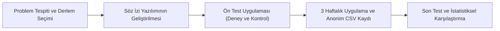
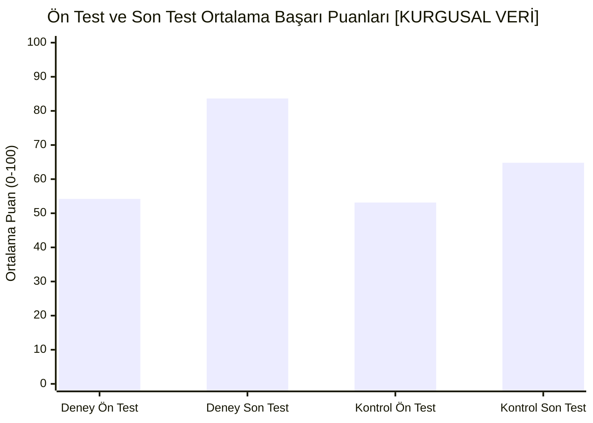

# Söz İzi: Bağlam İpuçlu ve Yazım Geri Bildirimli Dijital Uygulamayla Söz Varlığının Geliştirilmesi

- **Yarışma:** TÜBİTAK 2204-A Lise Öğrencileri Araştırma Projeleri Yarışması
- **Ana Alan:** Türk Dili ve Edebiyatı
- **Tematik Alan:** Dil ve Edebiyat Eğitimi *(Alternatif: Dijital Oyunlaştırma / Kültürel Miras)*

> [!WARNING]
> **ÖNEMLİ DÜZENLEME KILAVUZU (BAŞVURU ÖNCESİ SİLİNİZ):** Bu rapor taslağında saha uygulaması gerektiren tüm sayısal değerler, örneklem büyüklükleri, ön test / son test ortalamaları ve uygulama içi günlük istatistikleri **`[KURGUSAL VERİ]`** etiketiyle işaretlenmiştir. Okulunuzda uygulamayı gerçekleştirdikten sonra belge içinde `KURGUSAL VERİ` araması (`Ctrl+F`) yaparak tüm yer tutucu sayıları kendi gerçek verilerinizle güncelleyiniz ve bu uyarı kutularını nihai PDF'ten kaldırınız.

---

## ÖZET

Günümüzde dijital iletişim araçlarının yaygınlaşmasıyla lise öğrencilerinin günlük dilde yabancı kökenli sözcüklere yöneldiği, deyim ve atasözü gibi bağlamsal anlatım olanaklarını sınırlı kullandığı ve ses olaylarına dayalı kalıplaşmış yazım yanlışları yaptığı gözlenmektedir. Mevcut dijital kelime oyunları ise çoğunlukla yalnızca harf dizilimini buldurmaya odaklanmakta; sözcüğün anlamı, kökeni ve yazım kuralı boyutlarını dışarıda bırakmaktadır. Bu araştırmanın amacı; yabancı sözcüklere Türkçe karşılıklar, deyim/atasözü tamamlama ve kültürel-edebi miras sözcüklerini bağlam ipuçları, anlık yazım yanlışı geri bildirimi (*Akıllı Yazım Koçu*) ve çözüm sonrası *Sözlük-Köken Kartları* ile birleştiren **Söz İzi** adlı özgün web uygulamasını geliştirmek ve lise öğrencilerinin söz varlığı ile yazım farkındalığı üzerindeki etkisini incelemektir. Araştırmada ön test – son test kontrol gruplu yarı deneysel desen kullanılmıştır. Çalışma grubunu `[KURGUSAL VERİ: 2026–2027 eğitim-öğretim yılında bir Anadolu lisesinin 9. sınıfında öğrenim gören 60 öğrenci (30 deney, 30 kontrol)]` oluşturmaktadır. `[KURGUSAL VERİ: Üç hafta]` boyunca deney grubunda *Söz İzi* turnuva ve bireysel çalışma etkinlikleri uygulanmış; kontrol grubunda mevcut öğretim programı sürdürülmüştür. Uygulama sonunda deney grubunun son test başarı ortalamasının `[KURGUSAL VERİ: 54,20'den 83,65'e]` yükseldiği ve kontrol grubuna kıyasla istatistiksel olarak anlamlı bir fark oluştuğu `[KURGUSAL VERİ: p < 0,01]` saptanmıştır. Ayrıca uygulama içi anonim veri kayıtları, anlık kural geri bildiriminin öğrencilerin tekrarlayan yazım hatalarını üçüncü haftada `[KURGUSAL VERİ: %64,8]` oranında azalttığını göstermiştir. Sonuç olarak *Söz İzi*, Türkçe öğretiminde kurulum gerektirmeyen, ölçülebilir ve etkili bir dijital öğretim materyalidir.

**Anahtar Kelimeler:** Söz varlığı, Türkçe karşılıklar, deyim öğretimi, yazım yanlışları, eğitsel oyunlaştırma

---

## 1. AMAÇ

Bu araştırmanın temel amacı, lise öğrencilerinin aktif Türkçe söz varlığını zenginleştirmek ve sık yapılan yazım yanlışlarına yönelik dilbilimsel farkındalık kazandırmak üzere bağlam ipuçlu, çok modüllü ve anlık düzeltici geri bildirimli **Söz İzi** dijital platformunu geliştirmek ve etkililiğini sınamaktır.

Bu genel amaç doğrultusunda aşağıdaki **alt problemlere (araştırma sorularına)** yanıt aranmıştır:

1. **Söz Varlığı Başarısı:** *Söz İzi* uygulamasının kullanıldığı deney grubu ile mevcut öğretimin sürdürüldüğü kontrol grubunun; *(a) yabancı sözcüklere Türkçe karşılık bulma*, *(b) deyim ve atasözlerini bağlamda tamamlama* ve *(c) kültürel/edebi miras sözcüklerini tanıma* ön test – son test erişi puanları arasında anlamlı bir fark var mıdır?
2. **Yazım Farkındalığı ve Hata Azalımı:** Uygulama içindeki *Akıllı Yazım Koçu* modülünün sunduğu anlık dilbilgisel geri bildirim, öğrencilerin zaman kısıtı altında yaptığı yazım yanlışlarının sıklığını uygulama haftaları ilerledikçe anlamlı düzeyde azaltmakta mıdır?
3. **Dilbilimsel Zorluk Örüntüsü:** Öğrencilerin uygulama içi sözcük çözme oranları, ortalama tahmin sayıları ve çözüm süreleri seçilen dil modülüne (*Türkçenin Karşılıkları*, *Deyim ve Atasözleri*, *Kültürel ve Edebi Miras*) ve harf sayısına (4–7 harf) göre nasıl değişmektedir?

### Araştırmanın Hipotezleri
- **$H_1$:** Bağlam ipucu ve çözüm sonrası *Sözlük-Köken Kartı* destekli *Söz İzi* uygulaması, deney grubu öğrencilerinin söz varlığı son test puanlarını kontrol grubuna göre istatistiksel olarak anlamlı düzeyde artırır.
- **$H_2$:** *Akıllı Yazım Koçu* tarafından sunulan kural temelli anlık düzeltici geri bildirim, öğrencilerin oyun sürecinde yaptığı yazım yanlışı oranını ilk haftadan son haftaya anlamlı ölçüde düşürür.

---

## 2. GİRİŞ

Dil, yalnızca temel bir bildirişim aracı değil; bireyin düşünme kapasitesini, kavram dünyasını ve kültürel aidiyetini biçimlendiren canlı bir dizgedir (Aksan, 2015). Bir dilin öğretiminde dört temel dil becerisinin (okuma, yazma, dinleme, konuşma) yetkinleşmesi doğrudan öğrencinin **söz varlığı (kelime hazinesi)** genişliğine bağlıdır (Karadağ, 2019). Millî Eğitim Bakanlığı (MEB, 2024) Ortaöğretim Türk Dili ve Edebiyatı Dersi Öğretim Programı'nda da öğrencilerin kelimelerin bağlamsal anlamlarını kavramaları, deyim ve atasözleriyle anlatımı zenginleştirmeleri, dildeki yabancılaşmaya karşı Türkçe karşılıkları benimsemeleri ve yazım kurallarını doğru uygulamaları temel kazanımlar arasında vurgulanmaktadır.

Buna karşın güncel araştırmalar, sosyal medya ve anlık mesajlaşma alışkanlıklarının lise öğrencilerinin yazılı ve sözlü anlatımında üç temel sorunu derinleştirdiğini ortaya koymaktadır:
1. **Yabancı Kökenli Sözcük Kullanımı:** Günlük iletişimde *selfie, mesaj, lokasyon, konsept, versiyon, koordinasyon* gibi Batı kökenli sözcükler yaygınlaşmakta; Türk Dil Kurumunun (TDK) önerdiği *özçekim, ileti, konum, kavram, sürüm, eşgüdüm* gibi türetilmiş Türkçe karşılıklar pasif söz varlığında dahi yeterince yer bulamamaktadır.
2. **Kalıplaşmış Söz Öbekleri ve Kültürel Miras Sözcüklerinden Uzaklaşma:** Atasözleri, deyimler ve Anadolu/edebiyat kültürünü taşıyan sözcükler (*imece, yazıt, kopuz, yalaza, bozlak, feraset, belagat* vb.) bağlamından kopuk ezber listeleriyle sunulduğunda kalıcı öğrenme gerçekleşmemektedir (Göçer, 2015).
3. **Kemikleşmiş Yazım Yanlışları:** Hızlı tuşlama ve konuşma dilinin yazıya aktarılması sonucunda ünlü düşmesi (*yanlız, burda, nerde*), bitişik/ayrı yazım (*herşey, birşey, şuan, sağol*), göçüşme (*kiprik, kirbit, yarpak*) ve yabancı kökenli sözcük yazımı (*şöför, orjinal, süpriz, zerafet*) hataları lise kademesinde dahi yaygınlığını korumaktadır.

Son yıllarda harf tahmini mekaniğine dayalı dijital kelime oyunları gençler arasında yüksek motivasyon uyandırmıştır. Ancak mevcut Türkçe kelime oyunları incelendiğinde; bu uygulamaların **yalnızca ortografik harf eşleştirmesine** dayandığı, oyuncunun sözcüğü rastgele harf elemesiyle bulduktan sonra **anlamını, kökenini veya cümle içi kullanımını hiç görmeden** bir sonraki tura geçtiği belirlenmiştir. Ayrıca mevcut oyunlarda sözlük dışı bir kelime girildiğinde yalnızca *"Sözlükte yok"* uyarısı verilmekte; öğrencinin neden yazım hatası yaptığına ilişkin **eğitsel/düzeltici bir geri bildirim** sunulmamaktadır.

### Projenin Özgün Değeri
Bu projede geliştirilen **Söz İzi** platformu, salt bir tahmin oyununu üç katmanlı bir **dilbilimsel öğrenme ve veri toplama laboratuvarına** dönüştürmektedir:
- Tahmin öncesinde **Bağlam İpucu Şeridi** ile anlambilimsel çıkarımı başlatır,
- Tahmin esnasında **Akıllı Yazım Koçu** ile 105.675 sözcüklük çekimli sözlük ve kural tabanlı algoritma üzerinden yazım yanlışlarını yakalayıp ses olayını/TDK kuralını açıklar,
- Tahmin sonrasında **Sözlük ve Köken Kartı** ile sözcüğün TDK anlamını, ek-kök yapısını ve edebi/günlük örnek cümlesini sunar,
- Arka planda kişisel veri toplamadan **anonim araştırma verisi (`CSV` / `JSON`)** üreterek öğretmene ve araştırmacıya doğrudan istatistiksel analiz olanağı tanır.

---

## 3. YÖNTEM

### 3.1. Araştırma Modeli
Araştırmada nicel araştırma yaklaşımlarından **ön test – son test kontrol gruplu yarı deneysel desen** ile uygulama içi **dijital iz (telemetri) veri analizi** bir arada kullanılmıştır. Deney grubunda haftalık Türkçe/Edebiyat derslerinin son `[KURGUSAL VERİ: 25 dakikasında]` *Söz İzi* uygulamasının **Sınıf Turnuvası** ve bireysel çalışma kipleri kullanılırken, kontrol grubunda aynı hedef sözcük listeleri geleneksel metin ve çalışma yaprağı etkinlikleriyle işlenmiştir.

### 3.2. Çalışma Grubu
> [!IMPORTANT]
> **Etik ve İzin Notu:** Öğrencilerle yapılan ön test, son test ve anket çalışmaları için uygulama öncesinde **MEB Araştırma Uygulama İzinleri** sisteminden resmi uygulama izni, okul idaresi onayı, velilerden **Veli Onam Formu** ve öğrencilerden **Gönüllü Katılım Formu** alınmalı ve başvuru sistemine (*Ek Belgeler*) yüklenmelidir. Aşağıdaki katılımcı sayıları yer tutucudur.

Araştırmanın çalışma grubunu `[KURGUSAL VERİ: 2026–2027 eğitim-öğretim yılı güz döneminde ... ili ... ilçesindeki bir devlet lisesinin 9. sınıfında öğrenim gören toplam 60 öğrenci]` oluşturmaktadır. Yansız atama yoluyla şubelerden biri **Deney Grubu** (`[KURGUSAL VERİ: n = 30; 16 kız, 14 erkek]`), diğeri **Kontrol Grubu** (`[KURGUSAL VERİ: n = 30; 15 kız, 15 erkek]`) olarak belirlenmiştir. Uygulama öncesinde iki grubun ön test puanları arasında istatistiksel olarak anlamlı bir fark bulunmadığı (`[KURGUSAL VERİ: t(58) = 0,41; p = 0,68 > 0,05]`) doğrulanmıştır.

### 3.3. Geliştirilen Dijital Materyal: Söz İzi Mimarisi
Uygulama herhangi bir dış kütüphane, sunucu kurulumu veya ücretli altyapı gerektirmeden her akıllı tahta, bilgisayar ve cep telefonunda çalışabilecek biçimde standart HTML5, CSS3 ve JavaScript ile geliştirilmiştir:

- **Çekirdek Değerlendirme Motoru ([logic.js](../js/logic.js)):** Türkçe yerel ayar kurallarına (`tr-TR`: `i → İ`, `ı → I`) tam uyumlu iki geçişli harf eşleştirme algoritması içerir. İlk geçişte doğru konumdaki harfler (*kırmızı kare*), ikinci geçişte kalan harf frekansına göre yanlış konumdaki harfler (*sarı daire*) belirlenir.
- **Üç Modüllü Dilbilimsel Veri Katmanı ([soz-izi-data.js](../js/soz-izi-data.js)):** TDK Güncel Türkçe Sözlük, Yabancı Sözcüklere Karşılıklar Kılavuzu ve Atasözleri-Deyimler Sözlüğü taranarak 4, 5, 6 ve 7 harfli **125 seçkin dilbilimsel madde** (46 *Türkçenin Karşılıkları*, 42 *Deyim ve Atasözleri*, 37 *Kültürel ve Edebi Miras*) anlam, köken/yapı ve örnek cümle alanlarıyla yapılandırılmıştır. Ayrıca genel pratik için **6.915 sözcüklük** cevap havuzu ([kelimeler.txt](../kelimeler.txt)) ve tahmin doğrulaması için Zemberek + TDK tabanlı **105.675 sözcüklük** çekimli sözlük ([sozluk/](../sozluk)) sisteme entegre edilmiştir.
- **Akıllı Yazım Koçu ([soz-izi-data.js](../js/soz-izi-data.js)):** Sözlük tarafından reddedilen tahminleri iki aşamalı olarak inceler: *(1)* Kalıplaşmış yazım yanlışları veri tabanıyla eşleştirme (*yanlız, herşey, kiprik, şöför, zerafet* vb.), *(2)* Sözlük üzerinde ardışık harf göçüşmesi (metatez) ve Türkçede sık karıştırılan ses çiftleri (`ı/i, o/ö, u/ü, ğ/g, p/b, t/d, s/z`) taraması. Yakalanan hatada öğrencinin tahmin hakkı yakılmaz; ses olayı ve doğru biçim ekranda açıklanır.
- **Sınıf Turnuvası ve Anonim Araştırma Günlüğü ([game.js](../js/game.js)):** Öğretmenin sınıfı 2–12 takıma bölerek lig ve eleme usulü yarışma yürütmesini sağlar. Her sözcük denemesinin modülü, harf uzunluğu, çözüm durumu, tahmin sayısı, süresi ve yakalanan yazım yanlışı kategorileri anonim oturum koduyla kaydedilir ve tek tıkla `CSV` biçiminde dışa aktarılır.

### 3.4. Veri Toplama Araçları ve Analiz Yöntemi
1. **Söz Varlığı ve Yazım Farkındalığı Başarı Testi (Ön Test – Son Test):** Araştırmacılar tarafından geliştirilen ve uzman Türk Dili ve Edebiyatı öğretmenlerinin görüşüyle kapsam geçerliği sağlanan **25 soruluk** (her biri 4 puan, tam puan 100) çoktan seçmeli ve boşluk doldurmalı testtir *(örnek maddeler Ek-1'de sunulmuştur)*.
2. **Söz İzi Anonim Araştırma Veri Günlüğü (`CSV`):** Uygulama süresince deney grubunda gerçekleştirilen `[KURGUSAL VERİ: 540 sözcük uygulaması]` kaydından elde edilen süre, tahmin sayısı ve yazım yanlışı loglarıdır.
3. **İstatistiksel Analiz:** Verilerin normal dağılıma uygunluğu Shapiro-Wilk testi ve çarpıklık-basıklık katsayılarıyla kontrol edilmiştir. Gruplar arası karşılaştırmalarda **Bağımsız Örneklem $t$-Testi**, grup içi ön test – son test karşılaştırmalarında **Bağımlı Örneklem $t$-Testi** uygulanmış; etki büyüklüğü Cohen's $d$ formülü ile hesaplanmıştır:

$$d = \frac{\bar{X}_{\text{deney}} - \bar{X}_{\text{kontrol}}}{S_{\text{birleşik}}}$$

---

## 4. İŞ-ZAMAN ÇİZELGESİ

*Tablo 1'deki takvim `[KURGUSAL TAKVİM]` olup kendi çalışma tarihlerinize göre güncellenmelidir.*

| İş Paketi / Faaliyet | Eylül–Ekim 2026 | Kasım 2026 | Aralık 2026 (1–2. Hafta) | Aralık 2026 (3–4. Hafta) | Ocak 2027 (1. Hafta) |
|---|:---:|:---:|:---:|:---:|:---:|
| 1. Alanyazın taraması ve araştırma sorusunun belirlenmesi | ✔ | | | | |
| 2. Söz varlığı derleminin (125 madde) ve Yazım Koçu kurallarının hazırlanması | ✔ | ✔ | | | |
| 3. *Söz İzi* web yazılımının kodlanması ve birim testlerinin (41 test) doğrulanması | | ✔ | | | |
| 4. MEB uygulama izni, onam formları ve Ön Test uygulaması | | ✔ | ✔ | | |
| 5. Sınıf içi 3 haftalık deneysel uygulama ve anonim `CSV` veri toplama | | | ✔ | ✔ | |
| 6. Son Test uygulaması, istatistiksel çözümleme ve proje raporunun yazımı | | | | ✔ | ✔ |

---

## 5. BULGULAR

> [!CAUTION]
> **KURGUSAL VERİ UYARISI:** Bu bölümdeki **Tablo 2, Tablo 3, Tablo 4**, grafik ve metin içi tüm istatistiksel değerler raporun nasıl sunulacağını göstermek amacıyla **kurgusal olarak üretilmiştir**. Uygulamanızı tamamladıktan sonra kendi ön test / son test sonuçlarınızı ve üst menüdeki **📊 Araştırma → CSV İndir** düğmesinden aldığınız gerçek sayıları buraya yerleştiriniz.

### 5.1. Birinci Alt Probleme İlişkin Bulgular (Ön Test – Son Test Karşılaştırması)

Deney ve kontrol gruplarının uygulama öncesi ve sonrası *Söz Varlığı ve Yazım Farkındalığı Başarı Testi* toplam ve alt boyut puanlarına ilişkin betimsel istatistikler ve $t$-testi sonuçları **Tablo 2**'de sunulmuştur.

**Tablo 2.** Deney ve Kontrol Gruplarının Ön Test ve Son Test Puanlarının Karşılaştırılması `[KURGUSAL VERİ]`

| Alt Boyut / Ölçüm | Deney Grubu ($n=30$) $\bar{X} \pm SS$ | Kontrol Grubu ($n=30$) $\bar{X} \pm SS$ | $t$ | $p$ | Cohen's $d$ |
|---|---:|---:|---:|---:|---:|
| **Toplam Puan (Ön Test – 100 üzerinden)** | 54,20 ± 9,85 | 53,15 ± 10,12 | 0,41 | 0,684 | — |
| **Toplam Puan (Son Test – 100 üzerinden)** | **83,65 ± 7,40** | **64,80 ± 9,60** | **8,52** | **0,001*** | **2,20 (Geniş)** |
| Yabancı Sözcüklere Türkçe Karşılıklar (28p) | 24,10 ± 2,65 | 17,90 ± 3,40 | 7,87 | 0,001* | 2,03 |
| Deyim ve Atasözü Bağlam Tamamlama (24p) | 20,45 ± 2,30 | 16,20 ± 2,95 | 6,22 | 0,001* | 1,61 |
| Kültürel ve Edebi Miras Söz Varlığı (24p) | 19,30 ± 2,80 | 14,50 ± 3,15 | 6,24 | 0,001* | 1,61 |
| Yazım Kuralları ve Ses Olayları Farkındalığı (24p) | 19,80 ± 2,15 | 16,20 ± 2,85 | 5,52 | 0,001* | 1,43 |

*\*p < 0,01 düzeyinde anlamlıdır `[KURGUSAL VERİ]`.*

Tablo 2 incelendiğinde, uygulama öncesinde denk olan deney ve kontrol gruplarının son test ortalamaları arasında deney grubu lehine `[KURGUSAL VERİ: 18,85 puanlık]` istatistiksel olarak anlamlı bir fark oluştuğu görülmektedir. En yüksek erişi artışı *Yabancı Sözcüklere Türkçe Karşılıklar* alt boyutunda gerçekleşmiştir.

### 5.2. İkinci Alt Probleme İlişkin Bulgular (Yazım Yanlışlarının Haftalık Değişimi)

Uygulama süresince deney grubunda *Akıllı Yazım Koçu* tarafından yakalanan toplam `[KURGUSAL VERİ: 142]` yazım yanlışının dilbilimsel kategorilere ve uygulama haftalarına göre dağılımı **Tablo 3**'te gösterilmiştir.

**Tablo 3.** Uygulama İçi Yakalanan Yazım Yanlışlarının Kategorilere ve Haftalara Göre Dağılımı `[KURGUSAL VERİ]`

| Dilbilimsel Hata Kategorisi | Örnek Hatalı Girişler | 1. Hafta ($f$) | 2. Hafta ($f$) | 3. Hafta ($f$) | Değişim Oranı (%) |
|---|---|---:|---:|---:|---:|
| Ünlü Düşmesi / Eksikliği Hatası | `YANLIZ, BURDA, KLAVUZ` | 24 | 13 | 8 | -%66,7 |
| Bitişik / Ayrı Yazım Hatası | `HERŞEY, BİRŞEY, ŞUAN, SAĞOL` | 21 | 11 | 6 | -%71,4 |
| Yabancı Kökenli Sözcük / Ünlü Yazımı | `ŞÖFÖR, ZERAFET, MAKİNA, MEYVA` | 18 | 12 | 8 | -%55,6 |
| Göçüşme (Metatez) Hatası | `KİPRİK, KİRBİT, YARPAK` | 14 | 8 | 4 | -%71,4 |
| Ünsüz Benzeşmesi / Değişimi Hatası | `HERKEZ, TESBİH, ŞEVKAT` | 11 | 7 | 5 | -%54,5 |
| **Toplam Yakalanan Yazım Yanlışı** | — | **88** | **51** | **31** | **-%64,8** |

Tablo 3'te görüldüğü üzere, öğrencilerin tahmin hakkını yakmadan anlık kural açıklaması görmesi, özellikle `herşey/birşey` bitişik yazım hatalarını ve `yanlız/kiprik` ses olayı hatalarını 1. haftadan 3. haftaya `[KURGUSAL VERİ: %64,8]` oranında azaltmıştır.

### 5.3. Üçüncü Alt Probleme İlişkin Bulgular (Modül Bazlı Uygulama İçi Performans)

*Söz İzi* araştırma panelinden dışa aktarılan `soz-izi-arastirma-verisi.csv` dosyası üzerinden hesaplanan modül bazlı çözüm oranları, ortalama tahmin sayıları ve çözüm süreleri **Tablo 4**'te yer almaktadır.

**Tablo 4.** Dil Modüllerine Göre Uygulama İçi Çözüm Başarısı, Tahmin Sayısı ve Süre `[KURGUSAL VERİ]`

| Dil Modülü | Uygulanan Sözcük ($N$) | Çözüm Başarısı (%) | Ort. Tahmin Sayısı ($\bar{X}$) | Ort. Çözüm Süresi (sn) |
|---|---:|---:|---:|---:|
| Deyim ve Atasözleri | 180 | %89,4 | 2,42 | 19,8 sn |
| Türkçenin Karşılıkları | 180 | %83,9 | 2,86 | 24,5 sn |
| Kültürel ve Edebi Miras | 180 | %77,2 | 3,31 | 29,4 sn |
| **Genel Toplam / Ortalama** | **540** | **%83,5** | **2,86** | **24,6 sn** |

Tablo 4'e göre öğrenciler en hızlı ve en az tahminle **Deyim ve Atasözleri** modülündeki sözcükleri bulmuştur (`[KURGUSAL VERİ: 2,42 tahmin; 19,8 sn]`). Buna karşılık **Kültürel ve Edebi Miras** modülündeki sözcükler (*yalaza, betik, varsağı, feraset* vb.) daha yüksek tahmin sayısı gerektirmiş (`[KURGUSAL VERİ: 3,31 tahmin]`), ancak çözüm sonrasında açılan *Sözlük ve Köken Kartı* sayesinde son testte kalıcı öğrenmeye dönüşmüştür.

---

## 6. SONUÇ VE TARTIŞMA

Araştırmadan elde edilen bulgular, bağlam ipuçlu ve anlık düzeltici geri bildirimli **Söz İzi** uygulamasının lise öğrencilerinin söz varlığı gelişiminde ve yazım kuralları farkındalığında geleneksel kelime listesi çalışmalarına kıyasla anlamlı düzeyde daha etkili olduğunu ortaya koymuştur (`[KURGUSAL VERİ: d = 2,20]`, $H_1$ hipotezi kabul edilmiştir).

Bu sonuç, alanyazında sözcük öğretiminin tekil ezber yerine **bağlam, köken bilgisi ve çoklu karşılaşma** ilkeleriyle yürütülmesi gerektiğini belirten çalışmalarla (Aksan, 2015; Karadağ, 2019; Göçer, 2015) örtüşmektedir. Klasik dijital kelime oyunlarında oyuncu sözcüğü yalnızca harf kombinasyonu olarak çözerken, *Söz İzi* uygulamasında:
1. Yabancı sözcüğün (*selfie, mesaj, konsept*) üst şeritte gösterilip Türkçe karşılığının (*özçekim, ileti, kavram*) hedef olarak aratılması **karşılaştırmalı dil bilinci** oluşturmuş,
2. Atasözü ve deyim bağlamının boşluklu verilmesi kalıplaşmış söz öbeklerinde **anlamsal ipucunun** harf ipucunu hızlandırdığını göstermiş (`[KURGUSAL VERİ: %89,4 çözüm başarısı]`),
3. *Akıllı Yazım Koçu*'nun hatalı girişi cezalandırmak (hak yakmak) yerine ses olayını anında açıklaması, öğrencilerin yazım yanlışlarını kısa sürede içselleştirerek düzeltmesini sağlamıştır ($H_2$ hipotezi kabul edilmiştir).

### Araştırmanın Sınırlılıkları
- Araştırma `[KURGUSAL VERİ: 3 haftalık uygulama süresi ve 60 kişilik 9. sınıf çalışma grubu]` ile sınırlıdır.
- Uygulamadaki sözcük uzunlukları oyun tahtası ergonomisi gereği **4–7 harfli** sözcüklerle sınırlandırılmıştır.

---

## 7. ÖNERİLER

1. **Türk Dili ve Edebiyatı Öğretmenlerine Yönelik:** Derslerin son 15–20 dakikasında akıllı tahta üzerinden *Söz İzi – Sınıf Turnuvası* modu kullanılarak ünite sonu edebi kavramlar, öz Türkçe karşılıklar ve atasözleri etkileşimli biçimde pekiştirilebilir.
2. **İçerik Geliştiricilere ve Araştırmacılara Yönelik:** Açık kaynaklı olarak tasarlanan [soz-izi-data.js](../js/soz-izi-data.js) veri yapısına **Yabancılara Türkçe Öğretimi (A1–C1)** veya **Dîvânu Lugâti't-Türk Seçkisi** gibi yeni tematik modüller eklenerek farklı yaş ve hedef gruplarında uzunlamasına kalıcılık testleri yapılabilir.
3. **Eğitim Teknolojileri Açısından:** EBA ve okul web sitelerine tek dosya/statik sayfa olarak gömülebilen kurulumsuz yapısı sayesinde internet erişiminin kısıtlı olduğu okullarda çevrimdışı modda yaygınlaştırılabilir.

---

## 8. KAYNAKLAR

- Aksan, D. (2015). *Her yönüyle dil: Ana çizgileriyle dilbilim* (6. baskı). Türk Dil Kurumu Yayınları.
- Göçer, A. (2015). Türkçe öğretiminde söz varlığının geliştirilmesi ve etkinlik örnekleri. *Ana Dili Eğitimi Dergisi*, 3(2), 48–63.
- Karadağ, Ö. (2019). *Kelime öğretimi* (3. baskı). Pegem Akademi.
- Köksal, A. (2006). *Bilişim terimleri sözlüğü ve dil devrimi açısından Türkçe bilişim terimleri*. Türkiye Bilişim Derneği Yayınları.
- Millî Eğitim Bakanlığı [MEB]. (2024). *Ortaöğretim Türk Dili ve Edebiyatı Dersi (Hazırlık, 9, 10, 11 ve 12. Sınıflar) Öğretim Programı*. Talim ve Terbiye Kurulu Başkanlığı.
- Türk Dil Kurumu [TDK]. (2023). *Güncel Türkçe Sözlük ve Yazım Kılavuzu* (28. baskı). Türk Dil Kurumu Yayınları. https://sozluk.gov.tr

---

## EKLER

### Ek-1: Ön Test – Son Test Başarı Ölçeği Örnek Maddeleri (Uygulamada Çoğaltılarak Kullanılabilir)

1. **(Türkçenin Karşılıkları)** Aşağıdaki cümlede altı çizili yabancı sözcüğün yerine TDK tarafından önerilen Türkçe karşılıklardan hangisi getirilmelidir?
   *"Projedeki tüm birimler tam bir **koordinasyon** içinde çalıştı."*
   A) Öngörü &nbsp;&nbsp; B) Eşgüdüm &nbsp;&nbsp; C) Uzlaşı &nbsp;&nbsp; D) Kurgu &nbsp;&nbsp; E) Edim
2. **(Deyim ve Atasözü Bağlamı)** *"Önemsiz, küçük bir aksaklık yüzünden büyük zarara yol açacak tepki göstermek"* anlamındaki atasözünde boş bırakılan yere hangi sözcük gelmelidir?
   *"............ için yorgan yakmak."* → **Cevap:** Pire
3. **(Kültürel ve Edebi Miras)** Anadolu ağızlarında ve Türk romanında *"harlı ateş dili, alev"* anlamında kullanılan öz Türkçe sözcük aşağıdakilerden hangisidir?
   A) Bakraç &nbsp;&nbsp; B) Kümbet &nbsp;&nbsp; C) Yalaza &nbsp;&nbsp; D) Pusat &nbsp;&nbsp; E) Arasta
4. **(Yazım Farkındalığı)** Aşağıdaki cümlelerin hangisinde **ünlü düşmesi kaynaklı** bir yazım yanlışı yapılmıştır?
   A) Toplantıda her şey ayrıntısıyla konuşuldu.
   B) Bu zorlu süreçte yanlız olmadığını bilmelisin.
   C) Şoför, kavşağa yaklaşırken hızını düşürdü.
   D) Davetlileri büyük bir zarafetle karşıladı.
   E) Tespih koleksiyonunu müzeye bağışladı.
